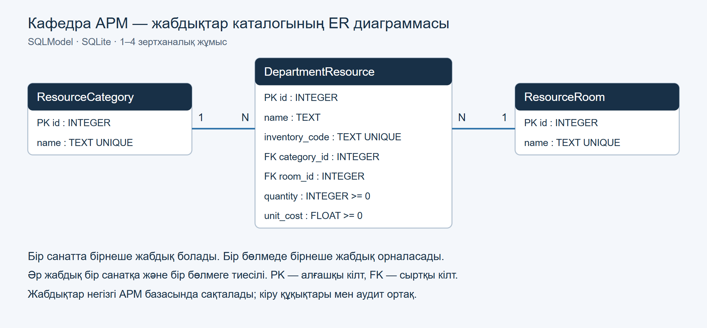

# Ақпараттық жүйе — Кафедра әкімшісінің АРМ-ы

**Курс:** Ақпараттық жүйелердің қолданбалы бағдарламалық қамтылымы, 2026 жыл.
**Автор:** ИС24А-КАЗ тобының студенті Қалмен Ермек.
**Нұсқа:** 19. **Репозиторий:** [applied-is-project-2026-arm](https://github.com/klmnve/applied-is-project-2026-arm).

## 1. Пәндік аймақтың сипаттамасы

Жүйе кафедра әкімшісінің пайдаланушыларды, оқу деректерін, құжаттар мен жабдықтарды басқаруын автоматтандырады. Әкімші рөлдер мен рұқсаттарды тағайындайды, оқытушы өз оқу жүктемесімен жұмыс істейді, студент өз тапсырмалары мен бағаларын көреді. Әр маңызды өзгеріс аудит журналында сақталады. Зертханалық жұмыстардағы жабдық каталогы атау, түгендеу коды, санат, бөлме және құн бойынша іздеуді, жазба қосуды, өзгертуді және жоюды орындайды. Streamlit каталогы қолданыстағы FastAPI серверіне қосылады; негізгі АРМ интерфейсі де сақталған.

Оқу деректері синтетикалық; сыртқы университет жүйесіне қосылу жоқ. Негізгі функциялар AI моделінсіз жұмыс істейді. Қосымша локалды AI аудит көмекшісінің баптауы [толық нұсқаулықта](docs/USER_GUIDE_KK.md) берілген.

## 2. Деректер архитектурасы



Диаграмманы өңдеу: [draw.io](docs/diagrams/resources-er.drawio) · [SVG](docs/diagrams/resources-er.svg).

| Модель | Деректер | Байланыс |
|---|---|---|
| `ResourceCategory` | Жабдық санатының ID-і мен атауы | Бір санатта бірнеше жабдық |
| `ResourceRoom` | Бөлменің ID-і мен атауы | Бір бөлмеде бірнеше жабдық |
| `DepartmentResource` | Атау, түгендеу коды, саны, бірлік құны | `category_id` және `room_id` сыртқы кілттері |

SQLModel модельдері `app/database/models.py` ішінде орналасқан. Каталог негізгі `data/audit.db` базасын пайдаланады; `ResourceSeedState` қызметтік белгісі бастапқы деректердің қайталануын және жойылған демонстрациялық жазбаның қайта пайда болуын тоқтатады. Бастапқы каталогта 3 санат, 3 бөлме және 4 жабдық бар.

Негізгі АРМ-да пайдаланушы, сессия, топ, студент, пән, оқу кезеңі, баға, тапсырма, құжат және аудит кестелері бар. `Roles` пен `Permissions` кестелері `RolePermissions` арқылы көп-көпке байланысады. Жабдықты оқу үшін `Documents.View`, өзгерту үшін нақты әкімші рөлі және `Users.Manage` қажет; өзгеріс пен аудит бір транзакцияда сақталады.

```text
app/
  database/                 SQLModel модельдері, engine, Session және seed
  routers/resources.py      Жабдықтарды оқу, қосу, өзгерту, жою және сүзу
  frontend/client.py        Cookie және CSRF қолданатын requests клиенті
  frontend/ui.py            Streamlit интерфейсі
  static/                   Негізгі АРМ және Swagger интерфейсі
  main.py                   FastAPI қолданбасының кіру нүктесі
tests/                      API, құқықтар және интерфейс тесттері
docs/                       ER диаграммасы, есептер және нұсқаулықтар
Dockerfile                  Backend image-і
Dockerfile.frontend         Frontend image-і
docker-compose.yml          Сервистер, желі және тұрақты volume
requirements.txt            Толық жергілікті әзірлеу ортасы
```

## 3. Технологиялық стек

- **Backend:** Python 3.11+, FastAPI, Uvicorn, Pydantic.
- **Database / ORM:** SQLite, SQLModel және SQLAlchemy; негізгі АРМ-ның қолданыстағы транзакциялық SQLite қабаты.
- **Frontend:** Streamlit 1.66.1 және Requests; негізгі АРМ үшін HTML/CSS/JavaScript.
- **Инфрақұрылым:** Docker, Docker Compose v2; `python:3.11-slim` негізіндегі екі image.
- **Тексеру:** pytest, FastAPI TestClient/HTTPX, Streamlit AppTest, Playwright, Ruff, MyPy.
- **AI құралы:** VS Code ортасындағы Codex — кодты толықтыру, ревью және тест сценарийлерін дайындау.

`requirements.backend.txt` және `requirements.frontend.txt` image-терге арналған runtime тәуелділіктерін бөледі. `requirements.txt` жобаны `-e .[dev,frontend]` арқылы орнатады. Парольдер мен дайын аккаунттар бастапқы кодқа енгізілмейді.

## 4. Жергілікті орналастыру

### Docker арқылы іске қосу

Docker Desktop немесе Docker Engine және Compose v2 қажет. Docker қолданғанда Python-ды хостқа бөлек орнату талап етілмейді.

```powershell
git clone https://github.com/klmnve/applied-is-project-2026-arm.git
cd applied-is-project-2026-arm
docker compose config
docker compose up --build -d --wait
docker compose ps
```

Жаңа volume-да алғашқы әкімшіні интерактивті түрде жасаңыз:

```powershell
docker compose exec backend python -m app.bootstrap --login ermek --name "Қалмен Ермек"
```

Пароль екі рет жасырын сұралады, ұзындығы 12–128 таңба. Дайын әдепкі пароль жоқ. Әкімші бұрын бар болса, bootstrap оны қайта жасамайды және паролін өзгертпейді.

| Қызмет | Мекенжай |
|---|---|
| Streamlit жабдық каталогы | http://localhost:8501 |
| Негізгі кафедра АРМ-ы | http://localhost:8000 |
| Swagger API құжаттамасы | http://localhost:8000/docs |
| Backend күйі | http://localhost:8000/api/health |

Streamlit-ке және браузердегі негізгі АРМ-ға кіру бөлек орындалады. Swagger-дегі қорғалған сұраулар үшін алдымен сол браузерде `http://localhost:8000` адресіне кіріңіз; Swagger өзгерту сұрауларына CSRF тақырыбын өзі қосады. `localhost` пен `127.0.0.1` хосттарын бір кіру сессиясында араластырмаңыз.

Compose **жаңа `arm_data` named volume** қолданады; компьютердегі бұрынғы `data/` қалтасы автоматты импортталмайды. База `/workspace/data/audit.db`, жүктелген файлдар `/workspace/data/uploads` ішінде сақталады. Негізгі жергілікті АРМ базасын көшіру қажет болса, алдымен оның резервтік көшірмесін дайындаңыз.

```powershell
# Контейнерлерді қайта құру, деректерді сақтау
docker compose down
docker compose up --build -d --wait
```

Әдеттегі `down` named volume-ды сақтайды. **`down --volumes` (`down -v`) деректерді де жояды.** Екі процесс root емес пайдаланушымен орындалады; порттар тек `127.0.0.1` адресіне жарияланады. Frontend backend healthcheck сәтті болғаннан кейін басталады.

Контейнер ішіндегі `BACKEND_URL=http://backend:8000` API байланысына арналған. `PUBLIC_BACKEND_URL` браузерге көрсетілетін АРМ/Swagger сілтемесін береді. Порттар бос болмаса, Compose іске қосар алдында PowerShell-де өзгертуге болады:

```powershell
$env:ARM_BACKEND_PORT = '8001'
$env:ARM_FRONTEND_PORT = '8502'
$env:PUBLIC_BACKEND_URL = 'http://localhost:8001'
docker compose up --build -d --wait
```

Бұл жағдайда интерфейс `http://localhost:8502`, АРМ және Swagger `http://localhost:8001` адресінде болады; контейнерлер арасындағы `backend:8000` өзгермейді.

### Docker қолданбай іске қосу

Python 3.11+ қажет. Дайын `.venv` бар болса, оны қайта құрмаңыз. Барлық команда жоба түбірінен орындалады.

```powershell
# Тек жаңа орнатуда
py -3.11 -m venv .venv

# Тәуелділіктер мен бастапқы деректер
.\.venv\Scripts\python.exe -m pip install -r requirements.txt
.\.venv\Scripts\python.exe -m app.seed
.\.venv\Scripts\python.exe -m app.database.seed

# Тек бірінші әкімші әлі жоқ болса
.\.venv\Scripts\python.exe -m app.bootstrap --login ermek --name "Қалмен Ермек"
```

Бірінші терминалда backend-ті іске қосыңыз:

```powershell
.\.venv\Scripts\python.exe -m uvicorn app.main:app --host 127.0.0.1 --port 8000
```

Екінші терминалда Streamlit-ті іске қосыңыз:

```powershell
.\.venv\Scripts\python.exe -m streamlit run app/frontend/ui.py --server.port 8501
```

Жергілікті клиенттің `BACKEND_URL` әдепкісі — `http://127.0.0.1:8000`. Қосымша баптаулар `.env.example` ішінде; қажет болса оны `.env` файлына көшіріңіз. `.env`, виртуал орта, база, uploads және уақытша артефактілер Git пен Docker build контекстіне жіберілмейді.

## 5. Тесттер және қорғау материалдары

Толық регрессия және код сапасын тексеру:

```powershell
.\.venv\Scripts\python.exe -m pytest
.\.venv\Scripts\python.exe -m ruff check app tests scripts
.\.venv\Scripts\python.exe -m ruff format --check app tests scripts
.\.venv\Scripts\python.exe -m mypy app scripts
```

Каталог пен Streamlit-ті жеке тексеру және нақты браузер/контейнер сценарийлері:

```powershell
.\.venv\Scripts\python.exe -m pytest tests/test_resource_system.py tests/test_streamlit_ui.py
.\.venv\Scripts\python.exe scripts/browser_resources_smoke.py
.\.venv\Scripts\python.exe scripts/docker_smoke.py
```

Browser сценарийіне Playwright Chromium қажет: алғашында `python -m playwright install chromium` орындаңыз. Docker сценарийіне жұмыс істейтін Engine және Compose қажет. Тексеру сценарийлері уақытша база/жеке Compose жобасын қолданып, негізгі жұмыс деректерін өзгертпейді.

2026 жылғы 12 қарашада [GitHub Actions тексерісінде](https://github.com/klmnve/applied-is-project-2026-arm/actions/runs/43167035722) **609 тесттің барлығы өтті**, соның ішінде Streamlit/HTTP клиентінің 11 тесті бар; қате және өткізіп жіберілген тест жоқ. Ruff, формат және MyPy тексерістері де өтті. Нақты браузерде кіру, CRUD, іздеу, шығу және мобильді көрініс тексерілді. Docker-дің екі сервисі Linux ортасында іске қосылып, `down/up` кезінде деректердің сақталуы расталды. Толық орындалу дәлелдері [5–7 жұмыс есебінде](docs/labs/REPORT_5_7.md) беріледі.

- [1–4 зертханалық жұмыс есебі](docs/labs/REPORT.md) және [20 бақылау жауабы](docs/labs/CONTROL_ANSWERS.md).
- [5–7 зертханалық жұмыс есебі](docs/labs/REPORT_5_7.md) және [15 бақылау жауабы](docs/labs/CONTROL_ANSWERS_5_7.md).
- [Код ревьюы және тексеру шектері](docs/labs/REVIEW_5_7.md).
- [Кафедра АРМ-ының толық қазақша нұсқаулығы](docs/USER_GUIDE_KK.md).

Git тарихы нақты жасалған коммиттерді көрсетеді: 1–4 жұмыстар 2026 жылғы 5 қарашада тіркелген. Жеті апталық жасанды тарих жасалмайды. Қорғауда диаграмманы, кіруді, іздеу/CRUD әрекеттерін, аудитті және нақты тест нәтижесін көрсетіңіз.
