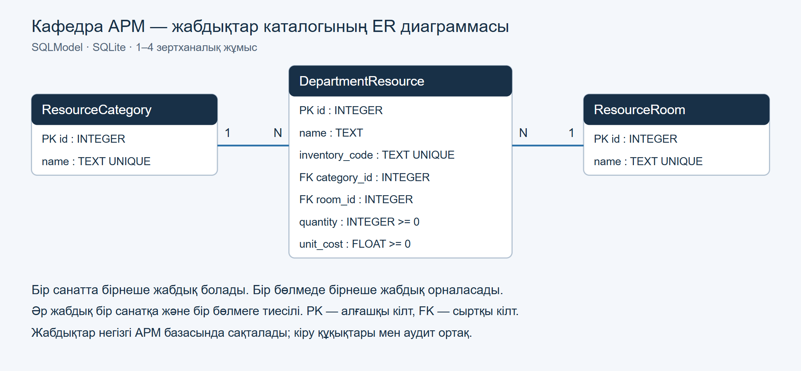

# Вариант 19 · Кафедра әкімшісінің АРМ-ы

## 1–4 зертханалық жұмыс

Осы АРМ негізінде кафедра жабдықтарының каталогы қосылды. SQLModel модельдері,
SQLite базасы, FastAPI маршруты және қолданыстағы авторизация мен аудит бірге жұмыс
істейді. Жабдықты қосуға, оқуға, жеке өрісін өзгертуге, физикалық жоюға және атау,
түгендеу коды, санат, бөлме, құн аралығы бойынша іздеуге болады.

- [Орындау есебі және қорғау сценарийі](labs/REPORT.md)
- [Бақылау сұрақтарына жауаптар](labs/CONTROL_ANSWERS.md)
- [Өңдеуге болатын ER диаграммасы](diagrams/resources-er.drawio)
- [GitHub репозиторийі](https://github.com/klmnve/applied-is-project-2026-arm)



Үш негізгі SQLModel кестесі: `ResourceCategory`, `ResourceRoom`,
`DepartmentResource`. Санат пен бөлме жабдықтарға **бір-көпке** байланысады.
Негізгі АРМ-дағы `Roles`, `Permissions`, `RolePermissions` кестелері көп-көпке
байланысының бар мысалы болып қалады.

```powershell
# Дайын .venv ортасын пайдаланыңыз
.\.venv\Scripts\python.exe -m pip install -r requirements.txt
.\.venv\Scripts\python.exe -m app.database.seed --echo
.\.venv\Scripts\python.exe -m uvicorn app.main:app --host 127.0.0.1 --port 8000
```

Негізгі АРМ: **http://127.0.0.1:8000**. Swagger:
**http://127.0.0.1:8000/docs**. Алдымен АРМ-ға сол браузерде кіріңіз;
Swagger өзгерту сұрауларына CSRF токенін өзі қосады. Алғашқы әкімшіні жасау
командасы төмендегі «Тез іске қосу» бөлімінде берілген. Жабдықтарды оқу үшін
`Documents.View`, өзгерту үшін әкімші рөлі және `Users.Manage` қажет.
Жаңа кестелер негізгі `data/audit.db` файлына қосылады; бұрынғы деректер сақталады.

| Әдіс | Маршрут | Нәтиже |
|---|---|---|
| GET | `/api/resources` | Іздеу, сүзгілер және беттелген тізім |
| GET | `/api/resources/{id}` | Бір жазба немесе 404 |
| POST | `/api/resources` | Тексерілген жаңа жазба, 201 |
| PATCH | `/api/resources/{id}` | Тек жіберілген өрістерді өзгерту |
| DELETE | `/api/resources/{id}` | Физикалық жою, 204 |
| GET | `/api/resource-categories`, `/api/resource-rooms` | Санаттар және бөлмелер |

Мысал сүзгі: `/api/resources?search=компьютер&min_cost=100000&max_cost=400000`.
Қате деректер — 422, қайталанған түгендеу коды — 409, жоқ жазба — 404.
`PATCH` кезінде жіберілмеген өрістер сақталады; бос өзгеріс пен міндетті өріске
`null` жіберу қабылданбайды. Өшіру мен аудит бір транзакцияда орындалады.

```powershell
.\.venv\Scripts\python.exe -m pytest tests/test_resource_system.py
```

IDE: орнатылған VS Code және Codex кеңейтімі. Жоба ортасы `.vscode/` арқылы
таңдалады. `.gitignore` виртуал орта, базалар, құпия конфигурация және уақытша
файлдарды репозиторийге жібермейді. Бұл бөлім 1–4 жұмыстардың бастапқы өзгерістерін сипаттайды. 5–7 жұмыстардың нәтижесі негізгі README мен бөлек есепте берілген.

[Қазақша](../README.md) · [Русский](../README.ru.md) · [English](../README.en.md)

Қол жеткізу құқықтарын басқару және әрекеттерді журналдау жүйесі. Python/FastAPI, SQLite және HTML/CSS/таза JavaScript қолданылады. Тіркелу, серверлік сессия, RBAC, тапсырмалар, бағалау, құжаттар және аудит **AI-сыз да жұмыс істейді**. AI аудит көмекшісі — локалды Ollama мен локалды көптілді embedding пайдаланатын қосымша бөлім.

Интерфейс қазақша, орысша және ағылшынша жұмыс істейді. Кіру бетіндегі және жоғарғы панельдегі тіл таңдауы localStorage-де сақталады. Дата/уақыт пен сандар `Intl` арқылы көрсетіледі; пайдаланушы енгізген есімдер, жұмыс мәтіні және бастапқы аудит себебі дерек ретінде бастапқы тілінде қалады.

Оқу деректері синтетикалық: 3 топ, 12 ойдан шығарылған студент, 3 пән, 2 семестр, 72 бастапқы баға және 40 аудит мысалы. Айдар Нұртаев, Мәдина Сәрсенова және басқа seed есімдері осы оқу мысалы үшін ойдан шығарылған; нақты адамдарға қатысты дерек емес, кездейсоқ сәйкестік болуы мүмкін. Университеттің сыртқы жүйесіне қосылу жоқ. Қолданушы аккаунттарына тұрақты пароль seed жасалмайды.

## Тез іске қосу

Python 3.11+ қажет. Барлық команданы репозиторийдің түбір қалтасынан орындаңыз. Осы жұмыс қалтасындағы дайын `.venv` ортасын пайдалануға болады. Жаңа орнатуда Windows PowerShell:

```powershell
py -3.12 -m venv .venv
.\.venv\Scripts\python.exe -m pip install -e '.[dev]'
Copy-Item .env.example .env
.\.venv\Scripts\python.exe -m app.seed
.\.venv\Scripts\python.exe -m app.bootstrap --login YOUR_LOGIN --name "YOUR_DISPLAY_NAME"
.\.venv\Scripts\python.exe -m uvicorn app.main:app --host 127.0.0.1 --port 8000
```

`YOUR_LOGIN` және `YOUR_DISPLAY_NAME` орнына өз логиніңіз бен көрсетілетін есімді қойыңыз. Bootstrap құпиясөзді интерактивті терминалда **екі рет жасырын сұрайды**; кемінде 12, ең көбі 128 таңба. Пароль командалық аргументке, `.env` файлына немесе README-ге жазылмайды. Бірінші әкімші бар болса, команда басқа әкімші жасамайды және бұрынғы парольді өзгертпейді. Кейінгі әкімшіні жүйедегі белсенді әкімші рөл беру арқылы тағайындайды.

Браузерде **http://127.0.0.1:8000** ашып, өзіңіз жасаған аккаунтпен кіріңіз. Серверді тоқтату: `Ctrl+C`. Дайын `.venv` болса, оны қайта жасаудың қажеті жоқ. Python 3.11 немесе басқа қолдау бар нұсқасы орнатылса, алғашқы командада соны таңдаңыз.

Linux/macOS:

```sh
python3 -m venv .venv
. .venv/bin/activate
python -m pip install -e '.[dev]'
cp .env.example .env
python -m app.seed
python -m app.bootstrap --login YOUR_LOGIN --name "YOUR_DISPLAY_NAME"
python -m uvicorn app.main:app --host 127.0.0.1 --port 8000
```

Сервер де схеманы және синтетикалық оқу деректерін автоматты түрде дайындайды. `python -m app.seed` командасын қайталау бұрынғы жазбаларды/бағаларды қайта жазбайды, көшірме немесе аккаунт қоспайды. Бұрынғы `python -m app.db` аудит seed командасы да сақталған.

## Мұғалімге көрсету сценарийі

1. Бірінші әкімшіні bootstrap арқылы құрып, кіріңіз. Басты беттегі сандар дерекқордан есептеледі.
2. Тіркелу кезінде «Оқытушы» немесе «Студент» рөлін сұраңыз. `requested_role` нақты `role_code` өрісінен бөлек сақталады. Жаңа аккаунтпен кіруге болады, бірақ мақұлданғанша тек жеке өтінім күйі ашылады; жабық API-лар `403` қайтарады.
3. Әкімші «Өтінімдер» тізімінде өтінімді қарап мақұлдайды немесе себебімен бас тартады. Оқытушы өтінімі тек «Оқытушы» рөлімен мақұлданады; кейінгі рөл өзгерісі «Пайдаланушылар» бөлімінде бөлек жасалады. Әкімші, меңгеруші, аудитор рөлдерін тіркелуші сұрай алмайды. Студент үшін бар жазбаны қолмен таңдаңыз немесе тексерілген мәліметпен жаңа студент қосып, дұрыс топты растаңыз; бір жазба бір аккаунтпен ғана байланысады. Қайта байланыстыруды тек әкімші аудитпен жасайды. Оқытушыға «Оқытушылар → Оқытушы профилі → Оқу жүктемесін қосу» арқылы нақты пән/топ/кезеңді тағайындаңыз.
4. Оқытушымен кіріп, «Ведомостар» бөліміндегі бекітілген бағаны өзгертіңіз. Басқа пән/топ/семестр API арқылы сұралса да, сервер тыйым салады. «Тарих» өзгерістің авторын, UTC уақытын, IP және ескі/жаңа бағаны көрсетеді.
5. Құжат жүктеп, қараңыз. Әкімшімен құжатты жоюды растаңыз: ол тізімнен алынады, файл soft delete арқылы сақталады. Аудитте жүктеу, қарау және жою бар.
6. Оқытушыға бірнеше рет қате пароль енгізіп немесе тестте IP өзгертіп, ереже белгісін жасаңыз. Әкімші «Сессиялар» бөлімінде себебін көріп, шешімді өзі қабылдайды. Бұғатталған сессия токені дереу жарамсыз.
7. «Аудит журналы» бөлімінде actor, күн, әрекет, нәтиже, IP бойынша сүзгі қойыңыз; толық жазбаны ашыңыз. Журналды өзгерту/жою интерфейсі немесе API жоқ.
8. Қажет болса локалды модельдерді дайындап, «AI көмекші» бөлімінде аудитке сұрақ қойыңыз. Модель өшірулі болса да қалған бөлімдермен жұмыс жалғасады.

## Рөлдер мен құқықтар

Студент өтінімі аккаунт есімінен бөлек толық студент аты-жөнін, студенттік ID/сынақ кітапшасының нөмірін және оқу тобын жинайды. Нөмір шеттеріндегі бос орыннан тазаланып, бас әріпке нормалданады; 3–32 ASCII әріп/сан/`_`/`-` ғана рұқсат етіледі. Бұл — **расталмаған өтінім**, дайын `Students` байланысы емес. Оқытушы формасында студент өрістері жасырылған, өшірулі және payload-қа кірмейді. Ашық `GET /api/auth/registration-options` тек топтарды және email талаптарын береді; студенттер тізімін бермейді.

Әкімші өтінімдер тізімінде тек бүркемеленген нөмірді көреді. Толық нөмір мен email тек өтінім иесінің жеке күй бетінде және әкімшінің `GET /api/admin/requests/{id}` тексеру терезесінде ашылады. Әкімші мәліметті тексеріп, бар студентті қолмен таңдайды немесе жаңа жазба қосуды және дұрыс топты өзі растайды; ешбір студент, топ немесе растау белгісі автоматты таңдалмайды. Студентті мақұлдау `confirm_student_match=true` талап етеді. Бар жазбамен байланыстыруда айырмашылық немесе ескі өтінімде мәлімет жоқ болса, бөлек `acknowledge_mismatch=true` қажет; күмән болса, мәжбүрлеп байланыстырудың орнына «Қосымша тексеруге қайтару» қолданылады. Әр студентті мақұлдау үшін сервер жеке мәлімет жауабынан алынған бос емес, өзекті `claim_revision` мәнін де міндетті талап етеді: мән жоқ болса — 422, мәлімет өзгерсе — 409; соңғы жағдайда өтінімді қайта ашып тексеру қажет.

`POST /api/admin/requests/{id}/needs-review` себебін сақтап, аккаунтты pending/inactive және байланыссыз қалдырады. Иесі өз себебін көріп, «Өтінім деректерін түзету» арқылы `PUT /api/auth/student-claim` жібере алады; ол қайта тексеруге қайтады. Мақұлданған студент бұл жолмен дерегін не байланысын өзгерте алмайды. Мақұлдау рөлді, белсенділікті және нақты `student_id` байланысын бірге сақтайды; бір студентті екінші аккаунтқа қосу `409` береді. Бұрынғы `SYN-001..012` кодтары жарамды қалады. Құпиясөз, расталмаған өтінімдегі толық нөмір және email жалпы аудитке, сервер log-ына немесе өтінімдердің жалпы тізіміне жазылмайды. Рұқсаты бар қызметкер ресми студенттер тізімінде сақталған студенттік кодты көре алады.

Мақұлдау терезесінде екі тәсіл бар: әдепкі **бар студентті қолмен таңдау** немесе **тексерілген мәліметпен студент қосу**. Қосу тәсілінде әкімші каталогтан дұрыс топты өзі таңдап, аты-жөнді/кодты/топты тексергенін бөлек белгілейді; топ пен белгі автоматты таңдалмайды. UI `create_student=true`, `confirmed_group_id`, `confirm_student_match=true`, жаңа `claim_revision` жібереді және `student_id` жібермейді. Сервер дәл сәйкес бар жазбаны қайта пайдаланады. Код қайшылығы әрдайым `409 student_selection_required` беріп, қолмен таңдауды талап етеді. Код бөлек, бірақ аты-жөні бірдей болса, әкімші бар жазбаларды салыстырып, басқа адам екенін жеке белгімен растағаннан кейін ғана `confirm_distinct_student=true` арқылы бөлек студент қоса алады. Бұл белгі топ/тәсіл ауысқанда тазартылады және код қайшылығын айналып өтпейді. Жаңа `Students` жазбасы мен аккаунт байланысы бір транзакцияда сақталады. Өтінім мақұлданғанша ресми тізімге жаңа студент қосылмайды.

**Студенттер** бөлімінде ресми `Students` жазбаларының аты-жөні, коды және каталогтағы тобы көрсетіледі. «Барлық топтар», топ сүзгісі және аты-жөні/код бойынша іздеу бірге `GET /api/students?group_id=…&q=…&page=1&page_size=25` арқылы серверде орындалады; бос `group_id` жіберілмейді. Әкімші/кафедра меңгерушісі/оқытушыға `Grades.View` немесе `Users.Manage` құқығы қажет. Оқытушы тек өзіне бекітілген топтарды көреді; студент пен аудиторға тізім жабық. Каталог бос, нәтиже жоқ және сервер қатесі бөлек көрсетіледі. Тіркелу мен түзетуде аты-жөннің артық бос орындары тазаланып, 2–120 таңба тексеріледі; топтар жоқ болса, студент өтінімін жіберу бұғатталады. Оқытушыдан студент өрістері талап етілмейді.

Әр пайдаланушыда бір ағымдағы рөл бар; құқықтар дерекқордағы матрицадан **әр қорғалған сұрауда** қайта оқылады. Клиент рөл немесе actor ID жіберіп, өзін басқа пайдаланушы ретінде көрсете алмайды. Бұрынғы `X-Demo-User` авторизациясы алынып тасталды.

| Рөл | Бастапқы құқықтары |
|---|---|
| Әкімші | Барлық әкімшілік және оқу бөлімдері |
| Оқытушы | Dashboard, бекітілген топтардың студенттер тізімі/ведомость/баға, құжаттар, тапсырма жариялау және жұмыстарды бағалау |
| Студент | Өз тобының жарияланған тапсырмалары, өз жұмысы мен жарияланған бағасы |
| Кафедра меңгерушісі | Dashboard, студенттер тізімі, ведомость/құжат/тапсырма/жұмыстарды қарау, аудит |
| Аудитор | Dashboard және аудит; өзгерту құқықтары жоқ |
| Күтілуде / қабылданбаған | Кіру, жеке өтінім күйі, шығу; жабық бөлімдердің құқығы жоқ |

Permission codes: `Dashboard.View`, `Users.Manage`, `Roles.Manage`, `Grades.View`, `Grades.Edit`, `Documents.View`, `Documents.Upload`, `Documents.Delete`, `Sessions.Manage`, `Audit.View`, `Learning.View`, `Learning.Manage`, `Learning.Submit`. Әкімші матрицаны өзгерте алады. Оқытушының пән/топ шектеуі permission кодынан бөлек тексеріледі; permission беру оны айналып өтпейді. Студент рөліне аудит/басқару құқықтары қате қосылса да, сервер оларды бермейді. Соңғы белсенді әкімшіні тоқтатуға немесе әкімші рөлін алуға тыйым салынады. Әкімші рөлінен басқару құқықтарын алып, жүйені жабуға болмайды.

## Оқытушыны тіркеу және оқу жүктемесі

1. Оқытушы тіркелгенде аккаунт pending/inactive болады; студент өрістері қажет емес. Әкімші **Оқытушылар → Оқытушы өтінімдері** бөлімінде іздеп, профилін қарайды, мақұлдайды немесе қысқа себебімен қабылдамайды. Оқытушы өтінімі барлық кіру нүктесінде тек `teacher` рөлімен мақұлданады; рөл таңдау өрісі жоқ. Кейінгі рөл өзгерісі жалпы «Пайдаланушылар» бөлімінде бөлек орындалады. Жалпы «Пайдаланушылар» бөлімі жүйелік рөл/аккаунт басқаруы үшін сақталған.
2. Қажетті топ, пән немесе кезең жоқ болса, **Топтар мен пәндер** бөліміндегі тиісті қойындыдан қосыңыз. Оқу кезеңіне оқу жылы міндетті. Атауларды өзгертуге, мұрағаттауға және қайта белсендіруге болады; жою API-ы жоқ. Мұрағаттау бұрынғы баға/тапсырма/audit байланыстарын сақтайды, бірақ сол каталогпен жаңа тағайындау/тапсырма жасауға жол бермейді.
3. **Оқытушылар → Оқытушылар тізімі → Оқытушы профилі → Оқу жүктемесін қосу** арқылы нақты топ/пән/оқу кезеңін бірге таңдаңыз. Бірнеше жол қосуға болады. Бірдей tuple қайталанбайды. Әр жолды өзгерту атомарлы `PATCH /api/academic/assignments/{assignment_id}` арқылы, қайтарып алу бұрынғы `PUT /api/academic/assignments` арқылы жасалады. Профиль мен кесте өзгерістен кейін серверден қайта оқылады.
4. Оқытушының басты бетінде **Менің оқу жүктемем** нақты белсенді tuple-дарды көрсетеді. Тапсырма формасында бір толық тағайындау таңдалады; бөлек пән/топ тізімдерін араластырып қосымша scope жасау мүмкін емес. Тағайындау жоқ болса, тапсырма құру батырмасы жасырылып, баға/жұмыс бөлімінде кафедра әкімшісіне жүгіну туралы хабар көрсетіледі. Топ/пән/кезеңді мұрағаттау немесе тағайындауды қайтару ағымдағы сессияға да дереу әсер етеді.
5. Оқытушы аккаунтын тоқтату белсенді сессияларын аяқтайды; қайта белсендіру ескі токенді жандандырмайды. Оқытушы өтінімін кез келген кіру нүктесінен қабылдамау да pending сессияларын тоқтатады; қайта кіргенде тек өзінің қабылданбаған өтінім күйін көреді.

Оқытушыларды іздеу/күй/топ/пән сүзгісі және беттеу серверде `GET /api/admin/teachers` арқылы орындалады. Профиль — `GET /api/admin/teachers/{id}`; осы жердегі approve/reject/active өзгерістері арнайы endpoint-термен орындалады. Каталог — `GET/POST/PATCH /api/admin/catalogs…`; бұл бөлімдерге нақты admin рөлі және `Users.Manage` қажет. Оқытушының жүктемесі — `GET /api/academic/workload`. Барлық өзгеріс аудитпен бірге транзакцияда сақталады; рұқсат пен нақты tuple әр сұрауда DB-дан тексеріледі.

## Тапсырмалар және бағалау

«Құжат жүктеу» жалпы оқу құжатын сақтайды; ол тапсырма немесе дедлайн жасамайды. Тапсырманы «Тапсырмалар → Тапсырма жасау» арқылы жариялаңыз. Бастапқы материалды осы формада таңдасаңыз, `POST /api/tasks/with-material` файл мен тапсырманы бір транзакцияда сақтайды. Файл/құқық/аудит тексеруі сәтсіз болса, тапсырма жарияланбайды және жаңа файл тазаланады. Файлсыз тапсырмалар бұрынғы `POST /api/tasks` арқылы жасалады; кейін материалды жеке қосуға да болады.

Жаңа тапсырма мен өзгертілген дедлайн сервердің ағымдағы уақытынан кейін болуы керек; өткен уақыт `422 deadline_in_past` қайтарады. Бұрын жабылған тапсырманың дедлайнын өзгертпей атауын/ережесін немесе `allow_late` параметрін өңдеуге болады. Өзгертілмеген дата өрістері бастапқы UTC секундтары мен микросекундтарын сақтайды. Пайдаланушы жіберген `now`, `student_id` және уақыт өрістері сервердің нақты уақыты мен иелік тексеруін алмастырмайды.

1. Оқытушы «Тапсырмалар» бөлімінде бір толық бекітілген топ/пән/кезең комбинациясын таңдап, атауын, түсіндірмесін, жариялану уақытын және міндетті дедлайнды енгізеді. Қажет болса ереже мен қауіпсіз материал файлын қосады.
2. Студент өз тобының жарияланған тапсырмасын ашып, мәтін немесе файл жібереді. Дедлайнға дейін қайта тапсыруға болады. Дедлайнның дәл өз уақытынан бастап (`now >= deadline`) жаңа және қайталама тапсыру әдепкіде жабық. Оқытушы `allow_late=true` таңдаса, мерзімнен кейін де жіберу/жаңарту рұқсат, «кеш» белгісі қойылады.
3. Оқытушы өз ауқымындағы жұмысты қарап, пікір мен бүтін `0..100` баға қояды. Жариялау бөлек таңдалады. Жарияланбаған баға, пікір және тексеруші мәліметі студентке берілмейді; студент өзге студенттің жұмысын ID арқылы да аша алмайды.
4. Қайта тапсырған жұмыс бұрынғы тексеруді тазартады: оқытушы жаңа нұсқаны қайта бағалайды. Нұсқа нөмірі қатар жасалған өзгерістердің үстінен жазылуын болдырмайды. Жұмыс тапсырылғаннан кейін тапсырманың пән/топ/семестрін ауыстыруға болмайды.

Барлық дедлайн мен аудит UTC күйінде сақталады. Тапсырма уақыты жергілікті уақыт белдеуінде көрсетіледі. Баға, жариялау және пікір өзгерісінің actor/UTC/IP/ескі-жаңа баға деректері аудитте сақталады; жеке жұмыс пен пікірдің толық мәтіні аудитке көшірілмейді. AI баға қоймайды. Материалдар мен жұмыс файлдары құжаттардағы MIME/көлем/path/RBAC қорғанысын қолданады. «Анықтама» батырмасы рөл мен бетке сай 2–5 әрекетті қайта ашады.

Пікірдің нақты бұрынғы/жаңа мәтіні, баға, жариялау күйі, нұсқалар, actor/UTC/IP және audit ID бөлек `SubmissionReviewHistory` кестесінде бір транзакцияда сақталады. «Бағалау тарихы» терезесі мен `GET /api/submissions/{id}/history` тек рұқсат етілген қызметкерге ашылады; студенттер бұл тарихтан жарияланбаған баға не пікір ала алмайды. Жалпы аудитте пікірдің өзі емес, SHA256 және қажетті баға/нұсқа метадеректері сақталады.

## Қауіпсіздік және аудит

- Парольдер random salt бар **scrypt N=32768, r=8, p=3** арқылы хэштеледі. Параметрлер [OWASP scrypt нұсқауына](https://cheatsheetseries.owasp.org/cheatsheets/Password_Storage_Cheat_Sheet.html#scrypt) сай таңдалған. Парольдер plaintext күйінде сақталмайды және журналға берілмейді.
- Сессия токені кездейсоқ жасалады, `HttpOnly`, `SameSite=Strict` cookie-де беріледі. Базада токеннің және сессияға байланған CSRF мәнінің SHA-256 хэштері ғана сақталады. HTTPS ортада `COOKIE_SECURE=true` қойылады.
- Өзгертетін сұраулар `X-CSRF-Token` мәнін сессиядағы хэшпен тексереді; browser Origin/Fetch Metadata тексеруі де бар. Кіру қатесі аккаунттың бар-жоғын бірдей жауаппен жасырады; rate limit базада сақталады. Шығу/expiry/бұғаттау сервердегі сессияны жарамсыз етеді.
- Барлық SQL мәндері параметрлер арқылы беріледі. UI сенімсіз мәтінді `textContent` арқылы шығарады; CSP сыртқы скрипттер мен бетке ендіруді шектейді. Сыртқы URL-ге redirect қабылданбайды.
- Баға өзгерісі, GradeHistory және аудит — бір транзакция. Рөл/құқық, аккаунт, сессия және құжат метадеректерінің өзгерісі де аудитпен бірге commit/rollback жасайды. Аудит сәтсіз болса, маңызды бизнес өзгерісі сақталмайды.
- Аудитте actor логині, сол кездегі рөлі, UTC, IP, әрекет, нысан, нәтиже, reason және қажетті бизнес ескі/жаңа мәндер бар. SQLite триггерлері аудит жолын UPDATE/DELETE жасаудан қорғайды. Қолданбада бұларға endpoint жоқ.
- Пароль, session token/cookie, CSRF токені, embedding векторлары аудитке жазылмайды. AI сұрауына IP және old/new өрістері берілмейді. Қауіпсіз `reason` мәтіні ғана embedding алады.
- Әдепкіде клиент IP socket peer-ден алынады. `X-Forwarded-For` тек immediate peer `TRUSTED_PROXIES` ішіне кіргенде қолданылады; тізбек оңнан солға тексеріледі. Proxy жоқ болса бұл параметрді бос қалдырыңыз.

Құжаттар: PDF, UTF-8 TXT, PNG және JPEG, әдепкіде **5 MiB**. Кеңейтім, мәлімделген MIME, signature/мәтін және көлем тексеріледі; HTML/SVG/орындалатын файлдар қабылданбайды. Сервер UUID атауын жасайды, жолдар тек DB метадерегінен және тексерілген сақтау каталогынан құралады. Құжат рұқсат тексерілгеннен кейін attachment ретінде беріледі. Soft delete физикалық файлды бірден өшірмейді; SQLite және uploads қалтасын бірге backup жасаңыз.

## Сессия ережелері

Белгілеу шарттары детерминдік және AI-ға тәуелді емес:

- `SUSPICIOUS_WINDOW_SECONDS` ішінде логинге немесе IP-ге қатысты сәтсіз кіру саны `SUSPICIOUS_FAILURE_THRESHOLD` шегіне жетуі;
- бір сессияның соңғы белсенділігінен кейін сол уақыт аралығында IP ауысуы.

Екі ереже де себеп пен `session_flagged` аудитін жасайды және `awaiting_admin` күйіне қояды, бірақ өздігінен бұғаттамайды. Әкімші дәлел ID-лерін қарап, себебімен бұғаттайды немесе «жалған дабыл» деп шешеді; екі шешім аудиттеледі. Қосымша «AI шолу» тек ереже белгілеген белсенді сессияның қауіпсіз аудитін түсіндіреді: қорытынды нақты ID-лермен шектеледі, интерфейсте AI ұсынысы деп көрсетіледі. AI жаңа себеп/қауіп дәрежесін немесе блоктау шешімін шығара алмайды. AI өшірулі болса әкімшінің қолмен шешімі жұмыс істейді. Rate limit тәуелсіз сақталады.

AI таңдаған ID-лер бастапқы ереже дәлелдерін өшірмейді: байланысты сәтсіз кірулер модельге қауіпсіз өрістермен беріледі, барлық бастапқы/қатар қосылған дәлелдер сақталады. Әкімші шешімінің себебі басқару таңбалары тазаланғаннан кейін де кемінде 5 мәнді таңба болуы керек.

Бұғатты алу **ескі токенді қайта тірілтпейді**: сессия `revoked` болады, пайдаланушы жаңадан кіреді. Account active=false болғанда оның белсенді сессиялары да тоқтатылады.

## Конфигурация

`.env.example` құпиясыз бастапқы мәндерді береді; `.env` Git-ке қосылмайды. Салыстырмалы жолдар процесс іске қосылған ағымдағы қалтадан есептеледі: серверді репозиторий түбірінен іске қосыңыз. Өзгерткеннен кейін серверді қайта іске қосыңыз.

| Айнымалы | Әдепкі мән |
|---|---|
| `DATABASE_PATH` | `data/audit.db` |
| `UPLOAD_DIR` | `data/uploads` |
| `MAX_UPLOAD_BYTES` | `5242880` |
| `COOKIE_SECURE` | `false` (localhost HTTP); HTTPS-та `true` |
| `STUDENT_EMAIL_REQUIRED` | `false`; `true` болса, студентке оқу орнының email-і міндетті |
| `STUDENT_EMAIL_DOMAIN` | бос; берілсе, студент email-інің доменін сервер тексереді, мысалы `example.edu` |
| `SESSION_TTL_SECONDS` | `28800` (8 сағат, абсолютті expiry) |
| `LOGIN_MAX_ATTEMPTS` / `LOGIN_WINDOW_SECONDS` | `5` / `300` |
| `SUSPICIOUS_FAILURE_THRESHOLD` / `SUSPICIOUS_WINDOW_SECONDS` | `3` / `600` |
| `ALLOWED_ORIGINS` | `http://127.0.0.1:8000,http://localhost:8000` |
| `TRUSTED_PROXIES` | бос, comma-separated IP/CIDR |
| `OLLAMA_BASE_URL` / `OLLAMA_MODEL` | `http://localhost:11434` / `qwen2.5:1.5b` |
| `EMBEDDING_MODEL` / `EMBEDDING_PREFIX` | `models/multilingual-e5-small` / `query: ` |
| `SEMANTIC_THRESHOLD` | `0.80` |
| `LLM_TIMEOUT_SECONDS` / `MAX_CANDIDATES` | `180` / `500` |

Басқа port/hostname қолдансаңыз, `ALLOWED_ORIGINS` мәнін де соған сәйкестендіріңіз. App өздігінен proxy тақырыптарына сенбейді. Желіге ашқанда HTTPS пен cookie параметрлерін нақты орналастыру ортасына сай баптау қажет.

## AI көмекшісі: optional локалды модельдер

Негізгі жүйеге бұл қадамдар міндетті емес. AI үшін алдымен [Ollama қолданбасын/CLI-ін бөлек орнатыңыз](https://ollama.com/download/windows); Python-ның `.[models]` пакеті оны орнатпайды. Одан кейін:

```powershell
.\.venv\Scripts\python.exe -m pip install -e '.[models]'
ollama serve
```

Екінші терминалда:

```powershell
ollama pull qwen2.5:1.5b
.\.venv\Scripts\python.exe scripts/download_embedding.py --model intfloat/multilingual-e5-small --output models/multilingual-e5-small
```

Ollama қызметі қосулы, модельдер жүктелген болса, қайта жүктемеңіз. Қолданыстағы embedding каталогы сақталады. Модельдерді алғашқы дайындау файлдарды интернеттен жүктейді, ал **inference тек локалды**: embedding `local_files_only=True`, `trust_remote_code=False`; Ollama endpoint тек loopback origin қабылдайды, redirect/proxy environment қолданылмайды. API кілті немесе сыртқы inference сервисі жоқ.

E5 қазақша мен орысшаны қамтиды; semantic similarity үшін екі мәтінге де `query: ` prefix қолданылады. Prefix пен score шкаласы туралы [модель карточкасын](https://huggingface.co/intfloat/multilingual-e5-small) қараңыз. `0.80` — синтетикалық деректерге бапталатын шек, қауіп ықтималдығы/сенімділік бағасы емес.

AI SQL орындамайды. Жабық схема уақыт, action немесе actions тізімі, result, логин, IP, объект түрі/ID, reason semantic query және limit қабылдайды; белгісіз өріс пен қате JSON қабылданбайды. Нақты күн/логин/әрекет/IP backend кодында тексеріледі; күрделі reason intent үшін Ollama құрылымды JSON береді. Мысалдар: `login: teacher.one`, `IP: 203.0.113.17`, `object: grade/17`, `action: submission_review`. SQL тек параметрлермен орындалады. SQL арқылы сүзілген жазбалар ғана reason embedding салыстыруына өтеді, содан кейін `limit` қолданылады. IP бөлек тексерілген evidence ретінде интерфейске беріледі, модель мен embedding контекстіне кірмейді.

Дайын сұрақты басу нақты іздеуді бірден іске қосады; өңдеу кезінде үлгілер мен жіберу батырмасы уақытша жабылады. Қате берілген `login:`, `IP:`, `object:` немесе `action:` үнсіз алынып тасталмайды — `422 invalid_search_filter` қайтады. Сөйлем соңындағы нүкте тыныс белгісі ретінде алынады; нүктемен аяқталатын нақты идентификаторды тырнақшаға алыңыз: `login: "teacher.one."`.

Қорытынды моделі тек табылған жазбалардың минималды қауіпсіз өрістерін алады. Ол еркін айыптау/қауіп/себеп шығармайды: санақ, оқиға немесе журнал reason дәйексөзінің жоспары тексеріледі; backend мәтінді нақты audit ID-лерден құрастырады. Prompt injection нұсқау ретінде орындалмайды. Әр сілтеме бастапқы аудит мәліметін ашады. Модель жоқ болса AI `503 model_unavailable` қайтарады, негізгі модульдер тоқтамайды.

«Соңғы апта» — backend берген UTC уақыттан кері 7×24 сағат; «бүгін» UTC түн ортасынан басталады. DB пішімі — алты бөлшек таңбасы бар ISO UTC `Z`. Timestamp аралығы `[start_at,end_at)`: соңы кірмейді. Тек күндермен берілген аралық соңғы аталған күнді толық қамтиды. Seed кейінгі іске қосуларда тарихи уақыттарды жылжытпайды.

## Бұрынғы база және архитектура

v1/v2 базасы ашылғанда транзакциялық v3 upgrade орындалады. Бұрынғы аудиттің тоғыз өрісі мен ID-лері, бағалар, аккаунттар және пайдаланушы өзгерістері сақталады. Бұрын IP тіркелмеген мысалдар `unknown` болып қалады. Бұрынғы мақұлданған аккаунттар өз күйін сақтайды; бұрынғы pending аккаунттар өтінім болып қалады. Тек `SYN-001..012` кодына және дәл ескі placeholder атына сәйкес студент аттары жаңартылады; өңделген есімдерге тимейді. `PRAGMA user_version=3`; upgrade/seed қайталануы көшірме, пароль немесе бағаны қайта жазбайды. Backup үшін SQLite файлы мен uploads қалтасын бірге сақтаңыз.

- `app/store.py`, `db.py`, `seed.py`: SQLite, қауіпсіз upgrade, синтетикалық seed, аудит жазу.
- `app/auth.py`, `auth_routes.py`, `bootstrap.py`, `network.py`: пароль, сессия, CSRF, RBAC және actor IP.
- `app/academic.py`: ведомость, scope, баға тарихы, пән бекіту және құжаттар.
- `app/learning.py`: тапсырма/дедлайн, жеке жұмыс, қауіпсіз файл және оқытушы бағалауы.
- `app/core.py`: dashboard, аудит сүзгілері/беттеу/толық жазба және сессия басқару.
- `app/llm.py`, `embeddings.py`, `schemas.py`, `service.py`, `safety.py`: оқшауланған AI іздеу.
- `app/static/`: үш тілдегі SPA, орталық `locales.json` және `i18n.js`; framework/CDN жоқ. `app/i18n.py` API қатесі мен AI қорытындысын аударады.

API JSON схемасы: `/openapi.json`. `GET /api/health` — тек процесс liveness; `/api/readiness` — `Audit.View` арқылы қорғалған әкімшілік AI диагностикасы. Модель орнату командалары қолданушы интерфейсінде көрсетілмейді.

Студент өтінімін жаңарту `PRAGMA user_version=3` ішінде қосымша, қайталанатын миграциямен орындалады: жеке `StudentClaims` кестесінде `user_id`, `student_claim_name`, `student_claim_number`, `student_claim_group_id`, `student_claim_email` сақталады; `Users.request_review_required` тексеру белгісін сақтайды. Бұрынғы аккаунттар мен оқу жазбалары өшірілмейді. Ескі өтінімге студенттің есімі немесе нөмірі болжанып толтырылмайды; дерегі жоқ мақұлданбаған студент қосымша тексеруге жіберіледі.

## Тексеру

```powershell
.\.venv\Scripts\python.exe -m pytest
.\.venv\Scripts\python.exe -m ruff check app tests scripts
.\.venv\Scripts\python.exe -m ruff format --check app tests scripts
.\.venv\Scripts\python.exe -m mypy app scripts
.\.venv\Scripts\python.exe scripts/browser_smoke.py
.\.venv\Scripts\python.exe scripts/browser_smoke.py --student-claims-only
.\.venv\Scripts\python.exe scripts/browser_smoke.py --student-claims-only --require-student-email
.\.venv\Scripts\python.exe scripts/browser_smoke.py --student-roster-only
.\.venv\Scripts\python.exe scripts/browser_smoke.py --teachers-only
```

Pytest таза SQLite базаларымен auth/RBAC, CSRF/expiry/rate limit, соңғы әкімші, grade scope/атомарлық audit, файл қауіпсіздігі/soft delete, сессия ережесі/токенді тоқтату, аудит сүзгісі/беттеуі, SQL injection, seed/upgrade және сақталған AI сценарийлерін тексереді. Unit тесттерінде AI mock adapter анық inject жасалады; production fallback жоқ. Тест парольдері runtime-та кездейсоқ жасалады.

Browser smoke өз оқшауланған базасы мен random credential-дерін пайдаланады; әдеттегі базаға аккаунт қоспайды. Chrome/Edge болса соны headless қолданады; қажет болса Playwright Chromium-ін `python -m playwright install chromium` арқылы орнатыңыз. Скриншоттар `artifacts/browser-smoke/` ішіне сақталады. Браузер smoke-та AI әдейі өшірулі, сондықтан қалған сайттың тәуелсіздігі тексеріледі.

Ruff/MyPy/Pytest кэштері `.tools/` ішінде; `.venv`, модельдер, uploads және SQLite файлдары Git-ке қосылмайды. Егер алдыңғы sandbox жасаған temp қалтаның ACL шектеуі қалса, Pytest-ке жаңа бос `--basetemp=.tools/pytest-new-run` жолын беріңіз; жұмыс деректерін өшірмеңіз.

Төмендегі тарихи тексерістердің `artifacts/` файлдары жоба түбіріндегі жергілікті дәлелдерге жатады және GitHub-қа жіберілмейді. 5–7 жұмыстардың соңғы тексерісі [жеке есепте](labs/REPORT_5_7.md) берілген.

### Алдыңғы аудит кезеңінің тексерулері · 2026-10-15

Бұл аудит UI → валидация → API → серверлік құқық → сақтау/reload → нәтиже/қате → автоматты тест тізбегімен орындалды. Алғашқы «ішінара» бағалар түзетілген ақаулар мен сол сәтте әлі дәлелденбеген тізбектерді білдіреді.

| Талап | Бұрын | Қазір | Негізгі дәлел |
|---|---|---|---|
| Үш тіл | ішінара | толық | 561 аударма; locale/reload/рөл/модаль smoke |
| Тіркелу/мақұлдау | ішінара | толық | lifecycle тесттері; approve/reject/duplicate-link UI және 403 |
| Студент seed | ішінара | толық | idempotent seed/edited data preservation тесттері |
| Тапсырма/файл/дедлайн | ішінара | толық | UTC/DB/reload/UI; cutoff 409; atomic file/task rollback |
| Жұмыс/баға/пікір | ішінара | толық | old/new private history; жариялау; scope; rollback |
| Рөл/нұсқаулық | ішінара | толық | 5 рөл; 3 тіл; нақты навигация/анықтама/API 403 |
| AI аудит көмекшісі | ішінара | толық | 42 үлгі нақты API шақырады; нақты локалды модель/citation; invalid filter 422 |
| Күдікті сессия | ішінара | толық | 18 integrity регрессиясы; нақты AI ұсынысы; адам шешімі/токен/rate limit |
| Тест/құжат/іске қосу | ішінара | толық | толық pytest/Ruff/MyPy/browser; үш README; backup/DB integrity |

Толық endpoint/файл/тест сәйкестігі: artifacts/requirements-audit.json (`artifacts/requirements-audit.json`).

- Осы аудит алдындағы толық baseline: **273 passed** (540.47 секунд). Түзетулерден кейінгі бір толық жүгіріс: **333 passed** (909.57 секунд), failure/error/skip — **0**; **60 жаңа регрессия**. JUnit: audit-baseline.xml (`artifacts/audit-baseline.xml`), audit-final.xml (`artifacts/audit-final.xml`).
- `ruff check .`, `ruff format --check .` (**45 файл**), `mypy app scripts` (**24 source file**), екі JavaScript модулінің syntax тексеруі және `pip check` өтті.
- Негізгі Chrome smoke (`artifacts/browser-smoke/result.json`): үш тіл, 10 әкімшілік бет, teacher/student мақұлдау, head/auditor-дың 27 көрінісі, reject/duplicate-student-link UI, нақты құқық 403, барлық оқу workflow-ы, 42 AI үлгісінің нақты API сұрауы және single-flight; **0 JavaScript қатесі**. Модель өшірулі кезде қалған модульдер жұмыс істеді.
- Соңғы UI регрессиялары (`artifacts/browser-smoke/ui-final-supplement-result.json`): үш тілдегі login pattern/бос сұрақ қатесі, жалпы құжат пен тапсырма формасының айырмашылығы, жұмыс істейтін «Тапсырма жасау» өтуі; сол ашық терезеде материал жүктеу → Edit **HTTP 200**, дедлайн микросекундтары сақталды. Жаңартылған i18n аудиті (`artifacts/browser-smoke/i18n-final-audit-result.json`): **192 көрініс**, **561 аударма**, аралас аударма/ARIA/JavaScript мәселесі жоқ.
- Нақты AI браузер тексеруі (`artifacts/browser-smoke/real-ai-ui-audit-result.json`): `qwen2.5:1.5b` + локалды E5, үлгіні басу → **HTTP 200**, **3 жазба/3 қорытынды/3 дұрыс citation**, IP evidence және толық аудитке өту; **22.42 секунд**. Қате IP сүзгісі **422**.
- Нақты сессия AI тексеруі (`artifacts/browser-smoke/real-session-ai-audit-result.json`): шын failed-login ережесі → UI AI шолу → локалды модель қорытындысы/дәлел; бастапқы ID сақталады, сессия белсенді қалады, шешімді әкімші қабылдайды. 18 integrity тесті (`artifacts/session-review-integrity.xml`) boundary/concurrency/бөгде дәлел/rollback/мәнді себепті тексереді.
- Жұмыс базасын жаңарту кезінде **81 аудит, 72 баға, 5 аккаунт, 10 сессия және барлық басқа кесте жолдары** өзгеріссіз сақталды; uploads өзгермеді; seed **0** көшірме қосты. Қосымша history кестесі дайын. Integrity/FK — **ok**. Backup: `data\audit.before-audit-20261015-040358.sqlite3`. Салыстыру нәтижесі (`artifacts/upgrade-audit-result.json`). Негізгі базаға тест аккаунттары қосылған жоқ.

Сұралған талаптар ішінде ашық қалған ақау тіркелмеді. Бұл нәтиже жоғарыда аталған сценарийлер мен сақталған дәлелдер аясында берілді.

### Студент тіркелуі мен мақұлдауы: алдыңғы тексеру · 2026-10-15

Алдыңғы 333 тест сақталды; жаңа 86 жағдаймен толық жиын **419 passed**, failure/error/skip — **0**. JUnit (`artifacts/student-claims-full.xml`), API/schema/файл сәйкестігі бар толық есеп (`artifacts/student-registration-audit.json`).

Жаңа 22 интеграциялық тест пен 63 миграция/DB тексеруі және бір redaction регрессиясы: claim сақтау/нормалдау/бірегейлік, teacher payload қатесі, privilege escalation, pending API403, міндетті растау/жаңа revision, mismatch409, duplicate link409, қатар мақұлдау, audit rollback, owner correction, өз жұмысы мен жарияланған бағаға ғана қолжетімділік, басқа өтінімнің жеке дерегін де аудиттен жасыру тексерілді.

Нақты Chrome: толық негізгі smoke және `--student-claims-only` / `--student-claims-only --require-student-email` режимдері өтті. Екі email конфигурациясының әрқайсында kk/ru/en бойынша түзету/қосымша тексеру/бас тарту/сәйкессіздік/ескі revision409/қайта кірмей мақұлдау/бекітілген claim403 сценарийлері, бүркемеленген тізімдер және audit/server log құпиялығы тексерілді; JavaScript қатесі **0**. Optional email (`artifacts/browser-smoke/student-claims-result.json`), required email (`artifacts/browser-smoke/student-claims-email-result.json`).

`ruff check app tests scripts`, `ruff format --check app tests scripts` (**47 файл**), `mypy app scripts` (**26 файл**) және JavaScript syntax тексерулері өтті. Үш тілде **606** толық аударма бар. Жалпы `ruff check .` бөлек `lab6_tcp` қалтасындағы төрт ескертуді де табады; бұл студент ағынына қатысы жоқ файлдар өзгертілмеді.

Жұмыс базасын жаңарту кезінде **103 аудит, 72 баға, 6 аккаунт, 17 сессия**, пән бекітуі және барлық бұрынғы кесте жолдары сақталды. Жалған claim/аккаунт жасалмады, uploads өзгермеді, integrity/FK — ok. Backup және сақтау есебі (`artifacts/student-claim-upgrade.json`).

### Студенттер тізімінің браузер тексеруі · 2026-10-15

Нақты Chrome-дағы `--student-roster-only` **exit 0**: kk/ru/en бойынша расталмаған өтінімнің тізімге кірмеуі, аты-жөндегі бос орындарды тазалау, топты қолмен растау, жаңа студент пен аккаунт байланысы, аты-жөні бірдей бөлек адамға міндетті жеке растау, сервердегі іздеу+топ сүзгісі және беттеу өтті. Меңгеруші/оқытушы/аудитордың **9** тілдік тексеруі, студент пен аудитордың API403 жауабы, аккаунт ауысқанда сүзгіні тазалау және оқытушы бекітуі жойылғанда бет қалпына келуі де өтті. JavaScript қатесі **0**; 390×844 бетте көлденең overflow жоқ және жабық мәзір толық экран сыртында. Нәтиже (`artifacts/browser-smoke/student-roster-result.json`), мобильді көрініс (`artifacts/browser-smoke/student-roster-mobile.png`).

Осы өзгерістен кейін `--student-claims-only` және `--student-claims-only --require-student-email` қайта орындалып, әрқайсысы үш тілде **exit 0** берді; жеке claim DOM-ының logout-та тазалануы, revision/mismatch, түзету және құпиялылық регрессиялары сақталды. Бұл кезеңде толық негізгі/AI smoke қайта орындалмады.

### Оқытушылар ағыны: браузер тексеруі · 2026-10-15

Нақты Chrome-дағы `--teachers-only` **exit 0**, kk/ru/en: pending тіркелу, тек teacher беретін мақұлдау, каталогты қосу/өзгерту/мұрағаттау/белсендіру, бірнеше нақты тағайындау және қайталануды болдырмау, атомарлы өзгерту/қайтару, тек бір tuple таңдайтын тапсырма формасы, жалған cross-product API403 және жүктеменің ағымдағы сессияда жаңаруы өтті. Бұрынғы баға сүзгісі қолжетімсіз болғанда автоматты тазаланып, нақты бос жүктеме хабары көрсетілді. Аккаунтты тоқтату, ескі токеннің қайта жанданбайтыны және оқытушы өтінімін қабылдамау тексерілді. Нәтиже (`artifacts/browser-smoke/teachers-result.json`), оқытушылар (`artifacts/browser-smoke/teachers-kk.png`), жүктеме (`artifacts/browser-smoke/teacher-workload-kk.png`), мобильді көрініс (`artifacts/browser-smoke/teachers-mobile.png`).

Толық `python scripts/browser_smoke.py` қайта орындалып, **exit 0** берді: **13 бөлім**, **42** автоматты AI сұрауының нақты unavailable күйі, **30** меңгеруші/аудитор көрінісі, жаңа exact-selector арқылы файл/дедлайн/тапсыру/жарияланған баға/тарих сценарийлері, сессия мен мобильді пернетақта тексерулері өтті. Жаңа сессиядан тікелей `#documents` ашылғандағы тапсырма shortcut-ы да тексерілді. `--student-roster-only` және optional/required-email claim режимдері де қайта өтті. Барлық браузер нәтижесінде JavaScript қатесі **0**; осы кезеңде нақты AI inference орындалмады. Толық smoke (`artifacts/browser-smoke/result.json`).

`ruff check app tests scripts`, `ruff format --check app tests scripts` (**56 файл**), `mypy app scripts` (**31 файл**) және JavaScript syntax өтті. Үш тілде **698** толық аударма бар.

## Нақты орналастыруға дейін

Бұл репозиторийдегі оқу жүйесі синтетикалық деректермен жұмыс істейді. Нақты университетке қосу, ұйымның identity provider/MFA/password recovery процесі, malware сканері, сыртқы immutable audit қоймасы, encrypted backups және retention тәртібі бұл нұсқаға қосылмаған. SQLite триггерлері filesystem/DB әкімшісіне қарсы криптографиялық tamper-proof кепілдік бермейді. Бұғатталған токен қайта іске қосылмайды; сенімді proxy/HTTPS параметрлері deployment ортасында бапталады. AI қорытындысы авторизацияны немесе әкімшінің шешімін алмастырмайды.

<!-- student-roster-verification -->

### Студенттер тізімі: API және деректердің соңғы тексеруі · 2026-10-15

Бөлек іске қосылған регрессиялық жиын: **419 passed**; жаңа мақұлдау: **29 passed**; жаңа тізім/API: **32 passed**. Барлығы **480 жеке сценарий**, failure/error/skip — **0**. Миграция мен redaction бойынша 64 тексеру қосымша қайталанып өтті; олар жалпы санға екі рет қосылған жоқ. Регрессия JUnit (`artifacts/student-roster-regression.xml`), мақұлдау JUnit (`artifacts/tests/student-roster-approval.xml`), тізім JUnit (`artifacts/students-roster.xml`).

`ruff check app tests scripts`, format (**51 файл**), `mypy app scripts` (**28 файл**), екі JS модулінің syntax тексеруі және **637** үштілді аударма өтті. Схема мен permission матрицасын өзгертудің қажеті болмады. Бұрынғы жолдар мен uploads екі initialize/seed іске қосылуынан кейін өзгеріссіз қалды. Сақтау/backup дәлелі (`artifacts/student-roster-preservation.json`), API, файлдар және барлық жаңа тексерулер есебі (`artifacts/student-roster-audit.json`).

Негізгі өзгерістер: `app/auth_routes.py`, `app/student_claims.py`, `app/students.py`, `app/main.py`, аудит action/i18n, `app/static/app.js`/`styles.css`/`locales.json`, екі жаңа тест модулі, браузерлік сценарий және үш README.

<!-- teacher-management-verification -->

### Оқытушылар мен каталогтар: соңғы тексеру · 2026-10-15

Бөлек соңғы іске қосулар: **480 регрессиялық**, **31 жаңа оқытушы**, **63 каталог/миграция** — барлығы **574 жеке сценарий өтті**, failure/error/skip — **0**. Бұрынғы claim миграциясының 63 тесті қосымша өтті; олар жалпы санға қайта қосылған жоқ. Регрессия JUnit (`artifacts/teacher-regression.xml`), оқытушы JUnit (`artifacts/tests/teacher-management-final.xml`), каталог JUnit (`artifacts/catalog-management.xml`).

Ruff/format `app tests scripts` (**56 файл**), MyPy `app scripts` (**31 файл**), екі JS syntax және **698** үштілді аударма тексерілді. Нақты Chrome мұғалім/каталог ағынын, негізгі оқу ағындарын және студент тіркелуі/тізімін тексерді; нәтижелер толық API/файл/тексеру есебінде (`artifacts/teacher-management-audit.json`). Жұмыс базасындағы барлық бұрынғы баған мәндері мен uploads сақталды; екі initialize/seed көшірме қоспады. Backup және сақтау дәлелі (`artifacts/teacher-preservation.json`).

<!-- /teacher-management-verification -->
