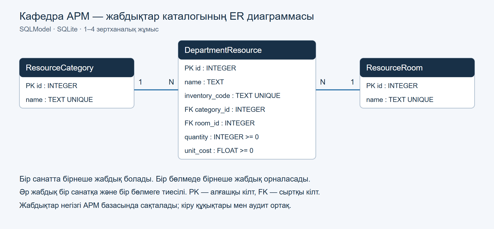

# Кафедра АРМ бойынша 1–4 зертханалық жұмыстың есебі

Жоба кафедра әкімшісінің жұмысын автоматтандырады: пайдаланушыларды, оқу деректерін, құжаттарды және әрекеттер аудитін басқарады. Осы төрт зертханалық жұмыс үшін сол жобаға кафедра жабдықтарының каталогы қосылды. Каталог қолданыстағы SQLite базасын, пайдаланушы сессияларын, рөлдік құқықтарды және аудит журналын пайдаланады.

**Пән:** Ақпараттық жүйелердің қолданбалы бағдарламалық қамтылымы. **Жыл:** 2026. Бұл есеп 1–4 зертханалық жұмысты қамтиды. 5–7 жұмыстар осы өзгеріске кірмейді.

## 1 зертханалық жұмыс — Жобалау және жұмыс ортасы

### Пәндік аймақ пен деректер моделі

Кафедра жабдықтарының атауын, түгендеу кодын, санын, бірлік құнын, санатын және орналасқан бөлмесін есепке алу қажет. Оқуға құқығы бар қызметкер каталогтан жабдықты іздейді; әкімші жаңа жазба қосады, өзгертеді және жояды. Әр өзгеріс аудитке тіркеледі.

| Модель | Мақсаты | Байланысы |
|---|---|---|
| `ResourceCategory` | Жабдық санаттары | Бір санатта бірнеше жабдық |
| `ResourceRoom` | Бөлмелер | Бір бөлмеде бірнеше жабдық |
| `DepartmentResource` | Жабдық карточкасы | Бір санатқа және бір бөлмеге жатады |



Диаграмманың өңделетін нұсқалары: [draw.io](../diagrams/resources-er.drawio) және [SVG](../diagrams/resources-er.svg). Негізгі АРМ-дағы `Roles` және `Permissions` кестелерін байланыстыратын `RolePermissions` аралық кестесі көп-көпке байланысының мысалы. Жаңа каталогта екі бір-көпке байланыс SQLModel `Relationship` арқылы берілген.

### Ортасы және файлдардың қызметі

Жұмыс ортасы — орнатылған VS Code және Codex кеңейтімі. Python тәуелділіктері жобаның `.venv` ортасына орнатылады. ИИ модельдер мен API құрылымын дайындауға және кодты тексеруге қолданылды; нәтижесі жобаның авторизациясы мен транзакцияларына сәйкестендірілді.

| Файл немесе каталог | Қызметі |
|---|---|
| `app/main.py` | FastAPI қолданбасын жинау, іске қосу және роутерлерді қосу |
| `app/database/models.py` | ORM модельдері және кіріс/шығыс схемалары |
| `app/database/db.py` | SQLite engine, кестелерді құру, сұрау сессиясы |
| `app/database/seed.py` | Синтетикалық бастапқы деректер |
| `app/routers/resources.py` | Жабдық каталогының CRUD API-ы |
| `app/static/` | Негізгі АРМ интерфейсі және Swagger беті |
| `tests/test_resource_system.py` | Каталогтың интеграциялық тексерістері |
| `requirements.txt`, `pyproject.toml` | Тәуелділіктер және жоба конфигурациясы |
| `.gitignore` | Виртуал орта, база, құпия және уақытша файлдарды Git-тен шығару |

Бастапқы код, схема, тәуелділіктер және құжаттама [GitHub репозиторийінің main тармағына](https://github.com/klmnve/applied-is-project-2026-arm) жүктелді. Жеке база, `.env`, сессиялар, жүктелген файлдар және `.venv` жарияланбайды. Локалды жоба `origin` арқылы осы репозиториймен байланыстырылған.

## 2 зертханалық жұмыс — SQLModel және SQLite

`ResourceCategory` және `ResourceRoom` модельдерінде алғашқы кілт `id` және бірегей атау бар. `DepartmentResource` моделінде `id`, `name`, `inventory_code`, `category_id`, `room_id`, `quantity`, `unit_cost` өрістері бар. Түгендеу коды бірегей; сан мен құн теріс бола алмайды. Санат пен бөлме идентификаторлары сыртқы кілттермен шектелген. SQLite қосылымында `PRAGMA foreign_keys=ON` іске қосылады.

`category` және `room` объектілік байланыстары екі бағытта `back_populates` арқылы көрсетілген. `init_db()` SQLModel метадеректерімен жетіспейтін кестелерді құрады. Қолданыстағы АРМ кестелері қайта құрылмайды. Әдепкі база жолы — `data/audit.db`; оны `DATABASE_PATH` арқылы өзгертуге болады.

```powershell
.\.venv\Scripts\python.exe -m pip install -r requirements.txt
.\.venv\Scripts\python.exe -m app.database.seed
```

Бос базаға 3 санат, 3 бөлме және 4 жабдық енгізіледі: оқу компьютері, проектор, принтер және оқытушы ноутбугі. Seed бір транзакцияда орындалады. Бір рет орындалу белгісі қайта іске қосқанда жазбаларды қайталауды, өзгерістерді қайта жазуды және жойылған демонстрациялық карточканы қайта жасауды болдырмайды. Жеке оқу базасын SQL логымен дайындау:

```powershell
.\.venv\Scripts\python.exe -m app.database.seed --database tmp/lab-is-demo.db --echo
```

`--echo` параметрі CREATE TABLE, INSERT және басқа SQL сұрауларын көрсетеді. Негізгі қолданбада SQL логы әдепкіде өшірулі. Жабдық бағасы оқу каталогындағы сандық өріс ретінде берілген; бухгалтерлік есеп жүргізілмейді.

## 3 зертханалық жұмыс — FastAPI және валидация

```powershell
.\.venv\Scripts\python.exe -m uvicorn app.main:app --host 127.0.0.1 --port 8000
```

Негізгі интерфейс — `http://127.0.0.1:8000`, күйді тексеру — `/api/health`, Swagger — `http://127.0.0.1:8000/docs`. Алдымен негізгі АРМ-ға кіріп, Swagger-ді сол браузерде және сол хост атауымен ашу қажет. Өзгерту сұрауларына Swagger беті CSRF cookie мәнін тақырыпқа қосады.

| Әдіс | Маршрут | Нәтиже |
|---|---|---|
| GET | `/api/resources` | `items` тізімі және беттеу ақпараты, 200 |
| GET | `/api/resources/{id}` | `item` объектісі, 200; жоқ болса 404 |
| POST | `/api/resources` | Жаңа `item`, 201 |
| GET | `/api/resource-categories` | Санаттар тізімі |
| GET | `/api/resource-rooms` | Бөлмелер тізімі |

Әр API сұрауы `Depends(get_session)` арқылы бөлек ORM сессиясын алады; контекст аяқталған кезде сессия жабылады. Тізімді оқу үшін `Documents.View`, өзгерту үшін нақты әкімші рөлі мен `Users.Manage` құқығы қажет. Жүйеге кірмеген клиент 401, құқығы жоқ клиент 403 алады.

Санаттар мен бөлмелер API-ынан нақты ID-лерді алып, мысалдағы `1` мәндерін қажет болса ауыстыру керек:

```json
{
  "name": "Зертхана мониторы",
  "inventory_code": "LAB-DEFENSE-001",
  "category_id": 1,
  "room_id": 1,
  "quantity": 2,
  "unit_cost": 75000
}
```

`ResourceCreate` кіріс схемасы `id` секілді артық өрістерді қабылдамайды. Бос атау, теріс сан/құн, жарамсыз сыртқы кілт — 422; бұрыннан бар түгендеу коды — 409. Сервер тағайындайтын ID клиенттен алынбайды.

## 4 зертханалық жұмыс — PATCH, DELETE және іздеу

`PATCH /api/resources/{id}` тек берілген өрістерді өзгертеді. `model_dump(exclude_unset=True)` жіберілмеген өрістерді жаңартуға қоспайды; `sqlmodel_update()` өзгерісті объектіге қолданады. Мысалы:

```json
{"quantity": 3}
```

Бұл сұрау атауды, кодты, санатты, бөлмені және құнды сақтайды. Бос `{}` және міндетті өріске `null` жіберу 422 қайтарады. Барлық жаңа сыртқы кілттер қайта тексеріледі.

`DELETE /api/resources/{id}` карточканы базадан физикалық жояды және бос денелі 204 қайтарады. Одан кейін сол ID-ге GET, PATCH немесе DELETE сұрауы 404 береді. Жабдық өзгерісі мен оның аудит жазбасы бір транзакцияда сақталады; аудит қатесі болса, өзгеріс те бекітілмейді.

Қолдау көрсетілетін сүзгілер: `search` немесе `q`, `category_id`, `room_id`, `min_cost`, `max_cost`, `page`, `page_size`. Іздеу атау мен түгендеу кодын қамтиды; қазақша әріптердің регистрін ескермейді. Мысал:

```text
/api/resources?search=компьютер&min_cost=100000&max_cost=400000&page=1&page_size=25
```

Сүзгілер SQLModel `select`/`where` арқылы құрылады. Пайдаланушы мәтіні SQL кодына біріктірілмейді. `%` және `_` іздеу мәтінінде арнайы маска ретінде кеңеймейді. `min_cost > max_cost` жағдайы 422 қайтарады.

## Қорғауда көрсету реті

1. ER диаграммасынан үш модельді, екі сыртқы кілтті және 1:N байланыстарын көрсетіңіз.
2. `models.py`, `db.py`, `seed.py`, `resources.py` файлдарының қызметін түсіндіріңіз.
3. Seed командасын екі рет орындап, екінші орындауда қайталанатын жазба қосылмағанын көрсетіңіз.
4. Серверді іске қосып, әкімшімен АРМ-ға кіріңіз. Бірінші әкімші жоқ жаңа орнатуда README-дегі `app.bootstrap` командасын қолданыңыз; пароль интерактивті енгізіледі.
5. `/docs` ішінде санаттар, бөлмелер және жабдықтар GET сұрауларын орындаңыз. Жоқ ID үшін 404 көрсетіңіз.
6. POST-қа `quantity: -1` жіберіп, 422 жауабын көрсетіңіз. Содан кейін жарамды карточка құрып, 201 мен жаңа ID-ді сақтаңыз.
7. Іздеу, санат/бөлме және құн аралығы сүзгілерін тексеріңіз. Бірдей түгендеу кодын қайта қосқанда 409 болатынын көрсетіңіз.
8. Жаңа карточканың тек санын PATCH арқылы өзгертіңіз. GET арқылы өзге өрістердің сақталғанын тексеріңіз.
9. Тек осы көрсетілімде құрылған карточканы DELETE арқылы жойыңыз. Оған қайта PATCH жіберіп, 404 көрсетіңіз.
10. Негізгі АРМ аудит журналынан қосу, өзгерту және жою жазбаларын көрсетіңіз; автоматты тексерісті іске қосыңыз.

```powershell
.\.venv\Scripts\python.exe -m pytest tests/test_resource_system.py
```

## Тексерілген нәтижелер

- Каталогтың 24 автоматты тесті өтті: `artifacts/tests/resources-labs1-4.xml`.
- Қолданыстағы API мен конфигурацияның 23 регрессиялық тесті өтті: `artifacts/lab1-4/regression.xml`. Осы тексеру жиынында барлығы 47 тест өтті.
- Қосылған backend коды, негізгі іске қосу файлы және диаграмма генераторы Ruff, форматтау және MyPy тексерістерінен өтті.
- Нақты Chrome браузерінде Swagger GET — 200, жарамсыз POST — 422, жарамды POST — 201 берді; JavaScript қатесі тіркелмеді: `artifacts/lab1-4/swagger-result.json`.
- Негізгі базаға seed орындағаннан кейін бұрынғы 19 кестенің барлық жолдарының хэштері өзгермеді. Жаңа каталогта 3 санат, 3 бөлме, 4 жабдық бар; SQLite тұтастығы мен сыртқы кілттер тексерісі өтті: `artifacts/lab1-4/preservation.json`.

Тексеру артефактілері жергілікті сақталады. Бұл мәтіндегі қорғау реті — орындауға арналған сценарий; оқытушы алдында қорғау өтті деген мәлімдеме емес. [20 бақылау сұрағының жауаптары](CONTROL_ANSWERS.md) бөлек берілген.
