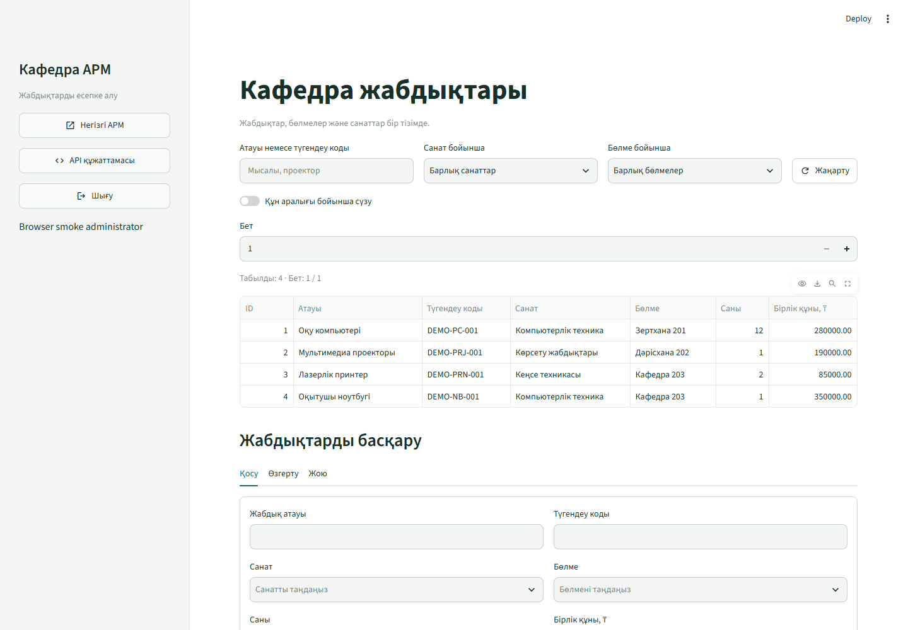

# Кафедра АРМ бойынша 5–7 зертханалық жұмыстың есебі

Бұл кезең 1–4 жұмыста құрылған SQLModel жабдық каталогына Streamlit клиентін, Docker арқылы іске қосуды және автоматты тексерістерді қосады. Каталог негізгі кафедра АРМ-ының FastAPI серверін, SQLite базасын, аккаунттарын, құқықтарын және аудит журналын пайдаланады. Жаңа клиенттің базамен байланысы тек HTTP API арқылы өтеді.

**Пән:** Ақпараттық жүйелердің қолданбалы бағдарламалық қамтылымы. **Жыл:** 2026.

**Орындаған:** ИС24А-КАЗ тобының студенті Қалмен Ермек.

Жобаны толықтыру және ревью үшін Codex қолданылды. [Репозиторий](https://github.com/klmnve/applied-is-project-2026-arm) және [1–4 жұмыстың есебі](REPORT.md) осы жұмыстың негізін береді.

## 5 зертханалық жұмыс — Streamlit интерфейсі



Клиенттің кіру нүктесі — `app/frontend/ui.py`. Пайдаланушы кафедра АРМ-ының логині мен паролі арқылы кіреді. Каталогта атау/түгендеу коды бойынша іздеу, санат, бөлме және құн аралығы бойынша сүзгі қолданылады. Әкімші жабдық қосып, карточканы өзгертіп және таңдаған жазбасын растаудан кейін жоя алады. Нәтиже серверден қайта оқылады.

Деректердің өту реті: **форма → requests → FastAPI → валидация және құқық тексерісі → SQLModel/SQLite → JSON жауап → кестені жаңарту**. Клиент формадағы мәндерді тексергенмен, түпкілікті шешімді backend қабылдайды. Оқу үшін `Documents.View`, өзгерту үшін әкімші рөлі мен `Users.Manage` қажет.

`app/frontend/client.py` ішіндегі `requests.Session` cookie-лерді сақтайды; ол әр Streamlit сессиясына бөлек беріледі. POST, PATCH және DELETE кезінде backend талап ететін CSRF тақырыбы жіберіледі. Қосылу уақыты 5 секундпен, жауапты оқу 20 секундпен шектелген; redirect автоматты орындалмайды. Клиент қосылым қатесін, timeout пен HTTP қатесін сәтті жауаптан ажыратады. `st.form` өзгерістерді бір жіберуге жинайды; іздеу мен сүзгі өзгерісі деректерді қайта сұратады.

Жергілікті іске қосу үшін екі терминал пайдаланылады:

```powershell
# Бірінші терминал
.\.venv\Scripts\python.exe -m pip install -r requirements.txt
.\.venv\Scripts\python.exe -m uvicorn app.main:app --host 127.0.0.1 --port 8000
```

```powershell
# Екінші терминал
.\.venv\Scripts\python.exe -m streamlit run app/frontend/ui.py --server.port 8501
```

Streamlit — `http://localhost:8501`, негізгі АРМ — `http://localhost:8000`, Swagger — `http://localhost:8000/docs`. Жергілікті клиенттің API мекенжайы `BACKEND_URL` айнымалысымен беріледі; әдепкі мәні `http://127.0.0.1:8000`. `PUBLIC_BACKEND_URL` браузерге көрсетілетін АРМ және Swagger сілтемелерін анықтайды. Streamlit кіру cookie-і Python клиентінде сақталады, сондықтан браузердегі негізгі АРМ/Swagger-ге кіру бөлек орындалады.

## 6 зертханалық жұмыс — Docker және Compose

| Файл | Мақсаты |
|---|---|
| `Dockerfile` | FastAPI серверінің image-ін құрастыру және Uvicorn іске қосу |
| `Dockerfile.frontend` | Streamlit клиентінің image-ін құрастыру |
| `docker-compose.yml` | Екі сервисті, порттарды, желіні және тұрақты дерек сақтау орнын сипаттау |
| `.dockerignore` | Құпия, жергілікті және уақытша файлдарды build контекстінен шығару |
| `requirements.backend.txt`, `requirements.frontend.txt` | Әр image-ке тек қажетті runtime тәуелділіктерін орнату |
| `scripts/docker_smoke.py` | Жеке уақытша Compose жобасында желі, API және volume сақталуын тексеру |

Екі image `python:3.11-slim` негізінде құрылады. Тәуелділіктерді орнату қабаты қолданба кодынан бұрын орналасқан. Процестер root емес `10001:10001` пайдаланушысымен орындалады. Compose желісінде frontend `http://backend:8000` адресін қолданады. Бұл мекенжайды Docker DNS шешеді; браузер тек жергілікті хостқа жарияланған `localhost:8000` және `localhost:8501` порттарына кіреді. SQLite базасы мен жүктелген файлдар `arm_data:/workspace/data` volume-ында сақталады. Frontend backend healthcheck сәтті болғаннан кейін басталады.

Docker Desktop немесе Docker Engine және Compose дайын ортада:

```powershell
git clone https://github.com/klmnve/applied-is-project-2026-arm.git
cd applied-is-project-2026-arm
docker compose config
docker compose up --build -d --wait
docker compose ps
```

Жаңа база үшін алғашқы әкімші интерактивті командамен құрылады:

```powershell
docker compose exec backend python -m app.bootstrap --login ADMIN_LOGIN --name "Кафедра әкімшісі"
```

`ADMIN_LOGIN` орнына өз логиніңізді жазыңыз. Пароль терминалда жасырын енгізіледі және image-ке не конфигурацияға жазылмайды. Бұрын әкімші бар болса, bootstrap оны қайта жасамайды және паролін ауыстырмайды.

Қайта құрастыруды көрсету кезінде volume-ды сақтаңыз:

```powershell
docker compose down
docker compose up --build -d --wait
```

`down --volumes` жұмыс деректерін де өшіреді. Контейнерді қайта құрастыру базаны қалпына келтірудің немесе резервтік көшірудің орнына жүрмейді. Docker құрастыруының орындалған күйі төмендегі тексеру нәтижелерінде бөлек көрсетіледі.

## 7 зертханалық жұмыс — Тесттер және қорытынды қорғау

`tests/test_resource_system.py` FastAPI `TestClient` арқылы GET, POST, PATCH, DELETE, іздеу, валидация, рөл, CSRF және аудит транзакциясын тексереді. Әр тестке уақытша база беріледі; жұмыс базасы өзгертілмейді. `tests/test_streamlit_ui.py` Streamlit `AppTest` және жасанды HTTP жауаптары арқылы интерфейсті, сессияларды және қателерді тексереді. Бұл тесттер нақты браузер/желілік тексерістен бөлек бағаланады.

```powershell
.\.venv\Scripts\python.exe -m pytest
```

Жаңа интерфейсті жеке тексеру — `python -m pytest tests/test_streamlit_ui.py`; нақты Docker ортасын тексеру — `python scripts/docker_smoke.py`. Docker сценарийі кездейсоқ аты бар жеке жоба мен volume жасайды, синтетикалық дерекпен тексереді және тек өзінің уақытша ресурстарын тазалайды; негізгі АРМ базасын қолданбайды.

Негізгі ревью қорытындылары [кодты тексеру есебінде](REVIEW_5_7.md), ал теориялық түсіндірмелер [15 бақылау сұрағының жауаптарында](CONTROL_ANSWERS_5_7.md) берілген. README пәндік аймақты, ER диаграмманы, технологияларды, іске қосуды және тесттерді біріктіреді.

### Қорғау сценарийі

1. Compose конфигурациясын тексеріп, екі сервисті құрастырып іске қосыңыз. `docker compose ps` нәтижесін көрсетіңіз.
2. Streamlit бетін ашып, әкімшімен кіріңіз. Кестені іздеу, санат, бөлме және құн сүзгілерімен тексеріңіз.
3. Бірегей түгендеу коды бар көрсетілім карточкасын қосыңыз. Оның бір өрісін өзгертіп, нәтижені қайта оқыңыз.
4. Сол карточканы растаудан кейін жойыңыз. Сервер тізімінен және ID бойынша сұраудан оның жоғалғанын көрсетіңіз.
5. Оқуға құқығы бар әкімші емес аккаунтпен өзгертуге болмайтынын көрсетіңіз. Жүйеге кірмеген сұраудың 401 алатынын түсіндіріңіз.
6. Swagger-де жарамды POST үшін 201, жарамсыз дерекке 422 және жоқ объектіге 404 көрсетіңіз. Swagger-ге негізгі АРМ-да сол хостпен кірген браузерді қолданыңыз.
7. Автотесттерді орындап, өту нәтижесін көрсетіңіз. Аудит қатесі кезінде бизнес өзгерістің де қайтарылатынын тест мысалымен түсіндіріңіз.
8. Контейнерлерді volume-ды өшірмей қайта құрып, сақталған деректердің бар екенін тексеріңіз.
9. Git тарихынан нақты жасалған коммиттерді көрсетіңіз. Репозиторийде 1–4 жұмыстардың 2026 жылғы 5 қарашадағы коммиттері бар; бұл жалған жеті апталық тарих ретінде ұсынылмайды.

### Тексеру нәтижелері

- 2026 жылғы 12 қарашада Streamlit/HTTP клиентінің **11 тесті өтті**, қате мен сәтсіздік жоқ: `artifacts/streamlit-ui.xml`. Бұл AppTest және жасанды HTTP backend сценарийлері.
- Нақты браузер мен FastAPI серверінде кіру, қосу, іздеу, PATCH, растаумен жою, шығу және мобильді көрініс тексерілді. JavaScript қатесі жоқ; `artifacts/lab5-7/browser/result.json` нәтижесі — `passed`.
- Ruff және формат тексерісі барлық 70 Python файлы үшін өтті. MyPy жоба мен скрипттердің 43 бастапқы файлын, соның ішінде Linux платформасының параметрлерімен тексерді.
- Docker сценарийі 2026 жылғы 12 қарашада **GitHub Actions Linux ортасында өтті**: [Docker тексеру тапсырмасы](https://github.com/klmnve/applied-is-project-2026-arm/actions/runs/43167035722/job/131011187469). Екі сервис healthy күйіне жетті; root емес процесс, ішкі DNS, нақты HTTP арқылы кіру/CSRF/CRUD/іздеу/валидация және frontend health тексерілді. `down`/`up` арасында SQLite деректері, жүктелген файл және жойылған seed жазбасының күйі сақталды. Дәлел: `artifacts/lab5-7/final-ci/docker/smoke-result.json`.
- Осы Windows компьютерінде Docker және WSL жоқ; контейнерлердің орындалуы қашықтағы Linux runner-де расталды. Тексеру негізгі жұмыс базасын пайдаланбады.
- Толық регрессиялық жиынтық: **609 тест өтті, 0 қате, 0 сәтсіздік, 0 өткізіп жіберілген тест**; pytest уақыты — 173,169 секунд. [Сәтті CI іске қосылуы](https://github.com/klmnve/applied-is-project-2026-arm/actions/runs/43167035722) `89488350d37088f245b17d5d02abe1512729ae94` коммитін тексерді. Linux-тағы нақты браузер сценарийі де өтті, JavaScript қатесі жоқ. JUnit дәлелі: `artifacts/lab5-7/final-ci/tests/ci-tests.xml`; браузер дәлелі: `artifacts/lab5-7/final-ci/tests/browser/result.json`.
- Нәтижелердің репозиторийде сақталатын қысқаша көшірмесі: [verification_5_7.json](verification_5_7.json). Толық журналдар CI бетінде `tests-and-browser` және `docker-verification` артефактілерімен бірге берілген; CI артефактілерінің сақтау мерзімі — 14 күн.
