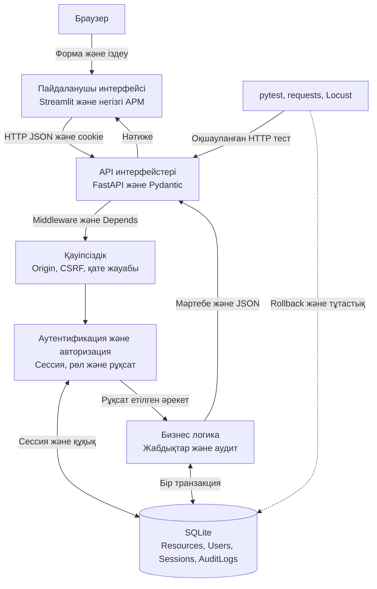
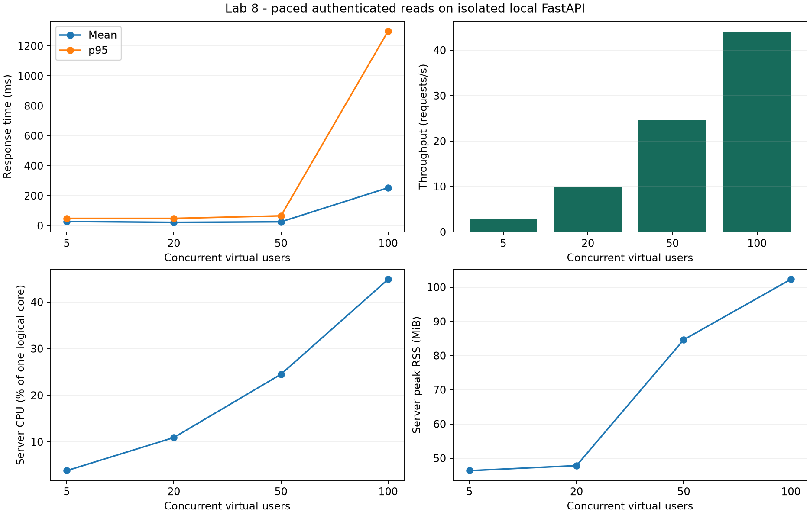
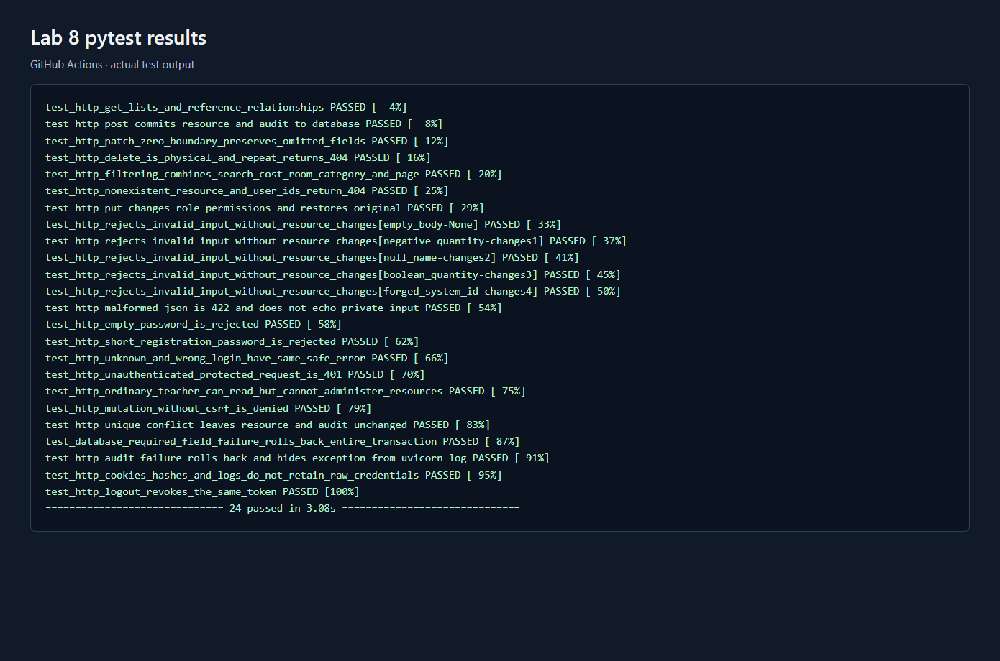
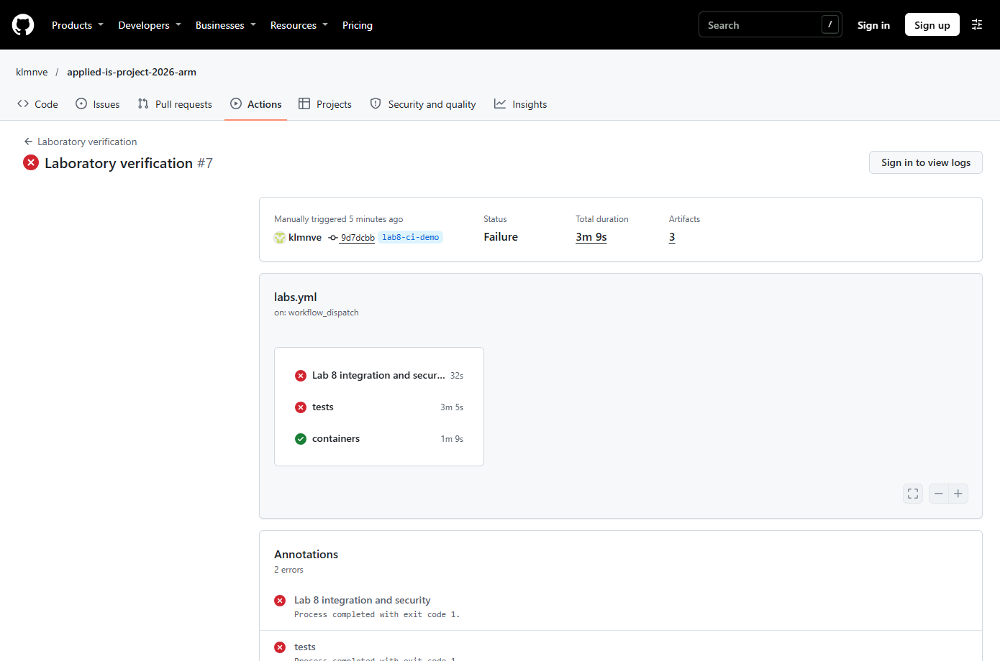
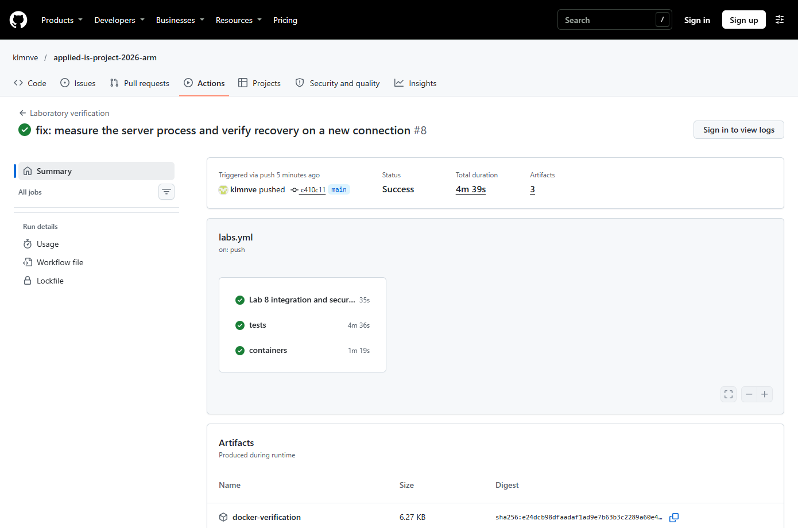

# 8 зертханалық жұмыс

## 1 Титулдық мәлімет

**Ақпараттық жүйені интеграциялық, жүктемелік және қауіпсіздік тестілеуі арқылы тексеру**

Ақпараттық жүйелердің қолданбалы бағдарламалық жасақтамасы пәні.

Орындаған ИС24А-КАЗ тобының студенті **Қалмен Ермек**.

Кафедра әкімшісінің АРМ-ы, бастапқы жобаның 19-нұсқасы. 2026 жылғы 19 қараша.

[8 жұмыстың берілген нұсқаулығы](https://chatgpt.com/s/t_6af4005ed7f88191a5fabf3cf1cedc50) және [жоба репозиторийі](https://github.com/klmnve/applied-is-project-2026-arm).

## 2 Жұмыстың мақсаты

№7 жұмыстағы АРМ компоненттерін бірге тексеру, нақты HTTP сұрауының дерекқорға дейінгі жолын бақылау, төрт жүктеме деңгейін салыстыру және қауіпсіздік шектеулерінің сақталуын бағалау. Нәтиже автоматты тесттермен, жүктеме өлшемдерімен, статикалық талдаумен және GitHub Actions дәлелдерімен расталады.

№8 жұмыстың жеке бағыттары ішінен 7-нұсқадағы қызметкерлерді басқару, рөлдер мен құқықтарды тексеру бағыты кафедра АРМ-ына бейімделді. Жұмыс жабдық каталогын, авторизацияны, аудитті және SQLite транзакцияларын қамтиды. Тексерістер уақытша база мен синтетикалық аккаунттарда орындалады; жұмыс базасының деректері жүктемелік тәжірибеге қолданылмайды. Бастапқы нұсқада 609 тесттің 2026 жылғы 12 қарашадағы өтуі [алдыңғы есепте](verification_5_7.json) сақталған; ол осы жұмыстың жаңа өлшемдерінің орнына жүрмейді.

## 3 Ақпараттық жүйенің архитектурасы



[Диаграмма бастапқы коды](../diagrams/lab8-architecture.mmd). Сызбада деректердің логикалық тексеру жолы берілген; авторизация мен қауіпсіздік тек UI-де емес, серверде орындалады. Streamlit браузері backend-ке тікелей кірмейді: HTTP сұрауын Streamlit серверінің `requests.Session` клиенті жасайды. Негізгі HTML/JavaScript АРМ API-ға браузерден жүгінеді.

Әр компонент үшін кемінде екі ықтимал ақау және қажетті интеграция:

| Компонент | 1 ықтимал ақау | 2 ықтимал ақау | Бірге тексерілетін бөліктер |
|---|---|---|---|
| Пайдаланушы интерфейсі | Backend өшкенде жалған «сақталды» хабарын көрсету | Басқа аккаунттың cookie-сін қайта пайдалану немесе ескі форма күйін жіберу | Streamlit → HTTP клиент → API, екі бөлек сессия |
| Серверлік бизнес логика | Өзгеріс сақталып, аудит сақталмауы | PATCH жіберілмеген өрістерді өшіруі | API → SQLModel/Store → SQLite және аудит |
| Дерекқор | Қате foreign key немесе қайталанған түгендеу коды сақталуы | Қате транзакциядан кейін жартылай өзгеріс қалуы | Session → SQLite шектеулері → rollback |
| Авторизация және аутентификация | Қате парольмен не тоқтатылған сессиямен кіру | Қарапайым пайдаланушының әкімші әрекетін орындауы | Login → Sessions → рөл/permission → қорғалған API |
| API интерфейстері | Бос/бүлінген JSON өңделмей 500 беруі | Жоқ ID үшін қате мәртебе немесе басқа объектінің ашылуы | HTTP → Pydantic → endpoint → база |
| Қауіпсіздік компоненттері | CSRF токенінсіз өзгеріс қабылдау | Пароль, сессия токені немесе ішкі traceback жауапта/log-та көрінуі | Middleware → auth → error handler → log/audit |

## 4 Қолданылған бағдарламалық құралдар

| Құрал | Осы жұмыстағы қызметі |
|---|---|
| Python, FastAPI, SQLModel, SQLite | Тексерілетін АРМ және дерек сақтау |
| pytest, requests | Автоматты сценарийлер және нақты HTTP интеграциясы |
| Locust | 5, 20, 50 және 100 виртуалды пайдаланушы |
| psutil, Matplotlib | Backend CPU/RSS өлшемдері және салыстыру графигі |
| Bandit 1.9.4 | Қауіпсіздікке қатысты Python код үлгілерін статикалық тексеру |
| GitHub Actions, Git | Код өзгерісінен кейінгі тексеріс және нәтижені сақтау |
| VS Code және Codex | Кодты толықтыру, ревью және дәлелдерді талдау |

Құралдардың нақты нұсқалары мен өлшеу компьютері жүктеме және тест артефактілерінде көрсетіледі. Postman орнына нұсқаулықта рұқсат етілген Python HTTP клиенті қолданылады.

## 5 REST API интеграциялық тестілеу нәтижелері

Тізімді оқу, жазба қосу, толық/ішінара өзгерту, жою және қате сұраулар нақты HTTP арқылы тексеріледі. Әр сценарий үшін сұрау әдісі, жолы, күтілетін және нақты мәртебе, құпиясы тазаланған жауап және қорытынды сақталады.

FastAPI бұл АРМ-да бос/қате пішінді кіріске 422 қайтарады. Нұсқаулықтағы жалпы 400 мысалына сәйкестендіру үшін шынайы нәтиже өзгертілмейді. Жоқ ресурс — 404, жүйеге кірмеу — 401, тыйым салынған әрекет — 403, бірегей код қайшылығы — 409.

2026 жылғы 19 қарашада жаңа Uvicorn процесіне `requests` арқылы **42 нақты HTTP сұрауы** жіберілді. Барлық байқалған мәртебе күтілген нәтижемен сәйкес келді. [Толық хаттамада](lab8/http-integration.json) әр сұраудың әдісі, жолы, күтілген/нақты мәртебесі және тазаланған жауап денесі сақталған. Төмендегі кесте негізгі жағдайларды жинақтайды.

| Сценарий және маршрут | Күтілген → нақты | Нақты жауап пен қорытынды |
|---|---|---|
| GET `/api/resources` | 200 → 200 | `total: 4`, `items` ішіндегі санат/бөлме байланыстары дұрыс |
| POST `/api/resources` | 201 → 201 | `item.id: 5`, код `LAB8-CREATE`; жол мен авторы көрсетілген аудит базаға жазылды |
| PATCH `/api/resources/6` | 200 → 200 | `quantity: 0`, `unit_cost: 0`; жіберілмеген өрістер сақталды |
| PUT `/api/admin/roles/auditor/permissions` | 200 → 200 | `Documents.View` қосылып, база күйі тексерілді; бастапқы құқықтар кейін қалпына келтірілді |
| DELETE `/api/resources/7` | 204 → 204 | Жауап денесі бос; жол физикалық жойылды |
| Жойылған жабдыққа GET/PATCH | 404 → 404 | Объект табылмады, жаңа жазба пайда болмады |
| GET `/api/admin/teachers/9000000000` | 404 → 404 | `teacher_not_found`; жоқ пайдаланушы ID-і қабылданбады |
| Бос дене, теріс сан, `null`, boolean сан, жалған `id` | 422 → 422 | `invalid_request`; жабдық пен оның аудиті өзгермеді |
| Бүлінген JSON | 422 → 422 | `invalid_request`; жеке сынақ мәтіні жауапқа көшірілмеді |
| Авторизациясыз GET `/api/resources` | 401 → 401 | Қорғалған каталогқа қолжетімділік жоқ |
| Оқытушының POST `/api/resources` әрекеті | 403 → 403 | `forbidden`; оқытушы оқи алады, әкімші әрекетін орындай алмайды |
| CSRF тақырыбынсыз POST | 403 → 403 | `csrf_failed`; база өзгермеді |
| Қайталанған түгендеу кодымен POST | 409 → 409 | `resource_conflict`; екінші жазба және оның аудиті қосылмады |
| Аудитке жазу кезінде енгізілген ақау | 500 → 500 | `server_error`; бизнес өзгеріс кері қайтарылды |

Мәртебелер жиынтығы — 200 × 15, 201 × 5, 204 × 1, 404 × 4, 422 × 8, 401 × 5, 403 × 2, 409 × 1 және әдейі ақау үшін 500 × 1. 500 бұл жерде күтпеген сәтсіз тест емес, rollback пен құпиялықты тексеруге арналған күтілетін жауап. Каталог ішінара өзгертуге PATCH қолданады; PUT талабы жобада бар рөл құқықтарын толық ауыстыру маршрутымен орындалды.

Ақау жағдайындағы нақты жауап:

```json
{"error":{"code":"server_error","message":"Сервер сұрауды өңдей алмады. Сервер күйін тексеріп, қайталаңыз."}}
```

## 6 Деректер қорын интеграциялық тексеру

API арқылы жазылған объект SQLite арқылы қайта оқылады; жаңартылған өріс, сақталған өзге өрістер және жойылған жол тексеріледі. UNIQUE қайшылығы, міндетті өріс және жарамсыз сандық кіріс жағдайларында негізгі деректердің сақталған күйі салыстырылады. Аудит сақтауға әдейі ақау енгізілген сценарийде бизнес өзгеріс те rollback болуы тиіс.

`PRAGMA integrity_check` және `PRAGMA foreign_key_check` дерек тұтастығын бөлек тексереді. Жауаптың мәртебесін ғана тексеру жеткіліксіз: транзакциядан кейінгі база күйі де assert арқылы расталады.

| Тексеру | Нақты нәтиже |
|---|---|
| POST → SQLite оқу → аудит | Жабдық атауы, саны 2, құны 75000 және `lab8_admin` авторының `resource_create` жазбасы сәйкес |
| PATCH → қайта оқу | Сан мен құн нөлге өзгерді, басқа өрістер сақталды |
| DELETE → SQL SELECT | Жол базада жоқ; кейінгі GET/PATCH — 404 |
| Бір транзакцияда жарамды INSERT, кейін `name=NULL` INSERT | Екінші INSERT `IntegrityError` берді; rollback бірінші INSERT-ті де жойды; бастапқы және соңғы snapshot тең |
| Қайталанған түгендеу коды | 409; жабдық пен оның аудитінің snapshot-тары өзгермеді |
| `AuditLogs` INSERT-іне арнайы қате trigger | HTTP 500; негізгі жабдық та, аудит те бекітілмеді; trigger тест соңында алынды |
| Тұтастық | `integrity_check: ok`, `foreign_key_check` бойынша 0 бұзушылық |

Міндетті өріс қателігіне арналған тест `test_database_required_field_failure_rolls_back_entire_transaction`, ал аудит ақауын тексеретін тест `test_http_audit_failure_rolls_back_and_hides_exception_from_uvicorn_log` деп аталады. Екеуі де өтті; нақты шарттар `tests/test_lab8_integration.py` ішінде берілген.

## 7 Жүктемелік тестілеу

Locust сұраулары арнайы іске қосылған жергілікті FastAPI серверіне жіберілді. Қалыпты пайдаланушы әрекеттері мен күту аралығы сценарийде бірдей сақталды; сценарийлер арасында пайдаланушылар саны мен ұзақтық өзгерді. Генератор мен бір Uvicorn процесі бір Windows компьютерінде жұмыс істеді, деректер уақытша SQLite базасында сақталды.

Әр виртуалды пайдаланушы бір синтетикалық әкімші аккаунтының жеке сессиясын қолданды. 100 сессия алдын ала ашылды; login уақыты өлшенетін аралыққа кірмейді. Сұраулар қоспасы каталог тізімі/іздеу/жеке жабдық/санаттар/бөлмелер/бақылау тақтасынан 3/2/2/1/1/1 салмақтарымен құралды. Әр әрекеттен кейін 1–3 секунд күту бар. Бұлар бизнес деректерін оқитын маршруттар болғанымен, авторизация әр сұрауда `Sessions.last_seen_at` жаңартады; демек өлшем HTTP, құқық тексерісі және базаға қолжетімділікті бірге қамтиды.

Барлық төрт сценарий берілген ұзақтығымен толық орындалды. Locust тарихы пайдаланушылардың нақты ең жоғары санын 5/20/50/100 деп растады. Қорытынды сандар соңғы JSON-нан алынды; мезгіл-мезгіл сақталған CSV соңғы аяқталған бірнеше сұраудан артта қалуы мүмкін.

| Пайдаланушы | Ұзақтығы, с | Сұрау | Орташа, мс | p95, мс | Сұрау/с | Қате саны және үлесі | Орташа CPU, % | Ең жоғары RSS, MiB |
|---:|---:|---:|---:|---:|---:|---:|---:|---:|
| 5 | 60 | 163 | 27,20 | 48 | 2,72 | 0 / 0% | 3,83 | 46,34 |
| 20 | 120 | 1181 | 21,65 | 48 | 9,87 | 0 / 0% | 10,93 | 47,82 |
| 50 | 180 | 4438 | 25,04 | 65 | 24,66 | 0 / 0% | 24,50 | 84,63 |
| 100 | 180 | 7945 | 252,73 | 1300 | 44,11 | 3 / 0,03776% | 44,87 | 102,29 |

CPU 100% бір логикалық ядроға тең; кесте бүкіл компьютерді емес, нақты сервер Python процесін көрсетеді. RSS — сол процестің жедел жады. psutil секундына бір рет өлшеді; Windows виртуалды ортасының іске қосқыш процесі есепке кірмейді. Виртуалды пайдаланушы саны бір мезеттегі сұрау санымен бірдей емес. p95 — Locust гистограммасының бағасы.

Өлшеу ортасы Windows 11, 4 физикалық/8 логикалық ядро және 7834,5 MiB RAM болды. Генератор Python 3.12.15, Locust 2.47.0, psutil 7.2.2 және Matplotlib 3.11.2 қолданды. Каталогта 4 жабдық, 3 санат, 3 бөлме және синтетикалық оқу деректері болды; компьютердегі басқа процестер тоқтатылған жоқ.



[JSON метрикалары](lab8/load-summary.json), [жиынтық CSV](lab8/load-summary.csv) және [толық әдістеме мен бастапқы CSV сілтемелері](lab8/load-report.md) нәтижені тексеруге мүмкіндік береді.

Бұл benchmark сервері 2026 жылғы 19 қарашада 05:15:20 UTC-де, log құпиялығы түзетілгенге дейін іске қосылды және бұрынғы өңдегішпен жұмысын аяқтады. Өнімділікке қатысты маршруттар, авторизация және SQLite жолы түзетуде өзгерген жоқ. Дегенмен кесте түзетілген нұсқаны қайта жүктемелеудің нәтижесі деп көрсетілмейді; түзетуден кейінгі құпиялық бөлек CI тестімен расталды.

### 50 және 100 пайдаланушыны салыстыру

Орташа уақыт 50 пайдаланушыдағы 25,04 мс-тан 100 пайдаланушыда 252,73 мс-қа, шамамен 10,09 есе өсті. p95 65 мс-тан 1300 мс-қа өсті; 100 пайдаланушыда p99 5200 мс, ең ұзақ жауап 12,45 секунд болды. Өткізу қарқыны 24,66-дан 44,11 сұрау/с-қа өскенімен, кешігу күрт артты.

Қате саны 0-ден 3-ке өсті. Екі іздеу және бір бөлмелер сұрауы HTTP 500 берді. Қалған 7942 сұрау 200-мен аяқталды. Сервер журналы осы ақауларда `sqlite3.OperationalError: database is locked` қатесін `current_principal → Store.connect → BEGIN IMMEDIATE` жолында көрсетті. SQLite жазу құлпы үш сәтсіз жауаптың себебі ретінде тіркелді. Оның жалпы кідіріске қосқан үлесі бөлек өлшенбеді. [Үш қатенің дерегі](lab8/load-errors.json).

Сервердің орташа CPU үлесі 24,50%-дан 44,87%-ға, ең жоғары RSS 84,63-тен 102,29 MiB-қа өсті. CPU-дың салыстырмалы өсімі шамамен 1,83 есе, RSS шыңының өсімі 1,21 есе болды. Бұл компьютердің барлық CPU немесе RAM ресурсы таусылғанын білдірмейді; ең айқын байқалған шектеу — қатар жүретін сессия жазуларындағы DB құлпы.

Келесі оңтайландыру қадамы — авторизация транзакциясының ұзақтығы мен құлыпты күту уақытын өлшеу. Одан кейін қауіпсіздік ережелерін сақтай отырып `last_seen_at` жазу жиілігін азайту, транзакцияны қысқарту және тұрақты үлкен жазу жүктемесі үшін PostgreSQL сияқты серверлік СУБД-ны бағалау ұсынылады. Қосымша worker SQLite жазу құлпын өздігінен жоймайды. Бұл жұмыста өнімділікті түзету енгізілген жоқ; өлшенген шектеу мен ұсыныс тіркелді.

Қайта орындау үшін репозиторий түбірінде негізгі backend ортасын README бойынша дайындап, бөлек жүктеме ортасын қолданыңыз.

```powershell
.\.venv\Scripts\python.exe -m venv .tools/lab8-load-venv
.\.tools\lab8-load-venv\Scripts\python.exe -m pip install -r requirements.load.txt
.\.tools\lab8-load-venv\Scripts\python.exe scripts/lab8_load.py
```

Скрипт өз уақытша серверін іске қосады, төрт сценарийді ретімен орындайды және соңында оны тоқтатады. Қайта орындау ағымдағы кодты қолданады; уақыт мәндері орта мен қатар жұмыс істейтін процестерге байланысты өзгеруі мүмкін.

Нәтиже осы компьютер, сұраулар қоспасы, деректер көлемі және бірнеше минуттық жүктемеге қатысты. Ол өндірістік желінің, ұзақ уақыттық тұрақтылықтың немесе барлық АРМ операцияларының өткізу қабілетін толық сипаттамайды.

## 8 Қауіпсіздік тестілеу нәтижелері

Міндетті сценарийлер: бос пароль, әлсіз пароль, қате логин, сессиясыз қорғалған ресурс, қарапайым пайдаланушының әкімші әрекеті және қате дерек пішімі. Бұған қоса CSRF, қате жауаптарында құпияның жасырылуы және серверлік log/audit-та пароль мен сессия токенінің болмауы тексеріледі. Статикалық анализ нәтижесі орындау тесттерінен бөлек беріледі.

| Қауіпсіздік сценарийі | Нақты нәтиже |
|---|---|
| Кірудегі бос пароль | 422 `invalid_request`; сессия cookie-і берілмеді |
| Тіркелудегі 12 таңбадан қысқа пароль | 422; жаңа пайдаланушы жасалмады |
| Жоқ логин және бар логиннің қате паролі | Екеуі де 401 және бірдей `invalid_credentials` жауабы |
| Сессиясыз қорғалған ресурс | 401 |
| Оқытушының әкімші әрекеті | 403; жабдық деректері өзгермеді |
| Бүлінген JSON және жарамсыз өрістер | 422; ішкі қате немесе кірістегі жеке маркер қайтарылмады |
| CSRF тақырыбы жоқ өзгеріс | 403 `csrf_failed` |
| Logout-тен кейін сол токенді қайта қолдану | 401; шығу серверлік сессияны тоқтатты |
| Пароль мен токенді сақтау | Пароль `scrypt` хэшімен, сессия/CSRF токендері хэш түрінде сақталған |
| Журнал мен аудит | Сынақ парольдері және бастапқы session/CSRF токендері табылмады |

Әлсіз пароль тексерісі нақты ұзындық шегін бағалайды; ол барлық парольдің энтропиясын немесе таралған парольдердің толық тізімін тексерді деген сөз емес. Қате логин жауабы аккаунттың бар-жоғын ашпайды. Қате туралы хабар ішкі exception мәтінін қамтымайды.

Bandit 1.9.4 бүкіл `app` каталогындағы 7863 жол кодты талдады. [Сақталған қорытындыда](lab8/bandit-summary.json) 48 ескерту бар — жоғары деңгейде 0, орташа деңгейде 24, төмен деңгейде 24. Сканерлеу қатесі жоқ.

| Ереже | Саны | Кодты тексергендегі бағалау |
|---|---:|---|
| B608, SQL құрастыру | 24 | Қаралған үлгілерде SQL атаулары/шарттары бекітілген, пайдаланушы мәндері параметрмен беріледі. Ескерту өздігінен SQL injection барын дәлелдемейді |
| B101, `assert` қолдану | 22 | `python -O` кезінде assert алынатындықтан ескертіледі. Қолжетімділік айқын шарттармен тексеріледі; assert-ке қауіпсіздік шекарасы ретінде сүйенуге болмайды |
| B105, парольге ұқсас жол | 2 | Екі сәйкестік — аудит әрекетінің атауы мен сипаттамасы, нақты пароль емес |

```powershell
.\.venv\Scripts\python.exe -m pip install bandit==1.9.4
.\.venv\Scripts\python.exe -m bandit -r app -f json -o artifacts/lab8/bandit-final.json --exit-zero
.\.venv\Scripts\python.exe -m bandit -r app -lll
```

Бірінші команда барлық ескертуді тіркейді, екіншісі жоғары қауіпті табылым болса тексерісті тоқтатады. Жоғары деңгейдегі табылымның болмауы барлық кодтың осалдықсыз екенін дәлелдемейді; динамикалық тестте табылған log мәселесі бөлек түзетілді.

## 9 Автоматты тестілеу нәтижелері

Жаңа сценарийлер қалыпты, шекаралық және қате кірістерді қамтиды. Ең аз талап — 10 автоматты тест және олардың ішінде кемінде 5 интеграциялық сценарий. Интеграциялық тесттің нақты шекарасы көрсетіледі: процесс ішіндегі TestClient, нақты сокеттегі requests немесе жеке дерекқор транзакциясы.

`tests/test_lab8_integration.py` құрамындағы **24 тест өтті**, сәтсіздік, қате және өткізіп жіберу саны — 0. Жергілікті орындау уақыты 18,312 секунд. Тесттер кемінде бес интеграциялық тізбекті қамтиды — API/база CRUD, сүзгілер, аутентификация/рөлдер, CSRF, транзакция rollback, аудит/log құпиялығы және сессияны тоқтату. Нақты HTTP сұраулары үшін TestClient емес, жеке Uvicorn процесіне TCP қосылымы қолданылды.

```powershell
.\.venv\Scripts\python.exe -m pytest -vv tests/test_lab8_integration.py --junitxml=artifacts/lab8/integration-tests.xml
```

JUnit дәлелі `artifacts/lab8/integration-tests.xml` ішінде, ал жариялауға арналған қорытынды [verification.json](lab8/verification.json) файлында сақталады. Басқа ортадағы CI ұзақтығы осы жергілікті өлшемнен бөлек қарастырылады.

Төмендегі сурет нақты GitHub Actions pytest журналының көрнекі көшірмесін береді; ондағы 3,08 секунд — CI ортасының уақыты.



## 10 CI және қате енгізу тәжірибесі

GitHub Actions [workflow-ы](../../.github/workflows/labs.yml) `main` тармағына код push болғанда, pull request ашылғанда және қолмен `workflow_dispatch` арқылы іске қосылады. Тек Markdown/`docs` өзгерістері үшін автоматты қайта іске қосу алынып тасталған. `Lab 8 integration and security` job-ы Ubuntu/Python 3.12 ортасында 24 тестті, Bandit есебін және жоғары қауіпті табылымдар тексерісін орындайды. JUnit, HTTP хаттамасы мен тазаланған log нәтижеге қарамастан артефакт ретінде жүктеледі.

Қосымша job-тар жалпы тесттерді, Ruff/MyPy, нақты браузерді және Docker сценарийін тексереді. Орындау журналы нақты commit пен job нәтижесіне байланысады. Әдейі қате енгізу тәжірибесі оқшауланған тармақта жасалады; негізгі тармаққа түзетілген код жіберілді. Бұл жұмыс автоматты сапа тексерісін қамтиды; өндірістік deploy жасалды деген мәлімдеме берілмейді.

Әдейі ақау `lab8-ci-demo` тармағында қайталанды. Бұл тармаққа `a3580b4` нұсқасындағы түзетуге дейінгі `app.main` алынып, тест fixture-іне `AuditLogs` жазуын тоқтататын SQLite trigger енгізілді. Trigger тек уақытша базаға қолданылады; негізгі жұмыс базасына не `main` тармағына әдейі ақау енгізілген жоқ. Бақыланатын қате DB жазуының сәтсіздігі арқылы log құпиялығының регрессиясын ашты.

| CI тәжірибесі | Commit және run | Lab 8 job-ының расталған нәтижесі |
|---|---|---|
| Қатені қайталау | `9d7dcbb366941e2be1b753279c173061ea085400`, [44464570642](https://github.com/klmnve/applied-is-project-2026-arm/actions/runs/44464570642) | 23 тест өтті, 1 тест сәтсіз; log-та жеке маркер бар |
| Түзетілген `main` | `c410c11d92fd689eda5ecdf13345d31dd4b6ac96`, [44464596179](https://github.com/klmnve/applied-is-project-2026-arm/actions/runs/44464596179) | Lab 8 job-ында 24 тест өтті, 0 сәтсіз; 3,083 секунд; жеке маркер жоқ |

Сәтсіз тесттің нақты себебі — `AssertionError: Synthetic private exception details leaked into Uvicorn logs`. Екі тәжірибеде де жалпы HTTP 500 және DB rollback дұрыс болды; айырмашылық сервер log-ындағы ішкі мәліметке қатысты. Түзетуден кейін дәл сол регрессия тесті өтті. Бұл main-ға код push болғаннан кейінгі автоматты тексеріс арқылы расталды.





Түзетілген `44464596179` run-ының **3 job-ы да сәтті аяқталды**. Толық JUnit нәтижесінде 633 тест өтті, сәтсіздік/қате/өткізіп жіберу саны 0, уақыт 177,209 секунд; жаңа 24 тест осы 633-тің құрамына кіреді. Нақты Chromium тексерісі desktop CRUD, мобильді көрініс және JavaScript қатесінің жоқтығын растады. Docker Compose job-ы SQLite мен жүктелген файлдардың сақталуын және жойылған seed жазбасының қайта қосылмауын тексерді. Қорытынды [verification.json](lab8/verification.json) файлында жинақталған.

## 11 Анықталған қателер және түзетулер

Нақты HTTP тесті бұрынғы қате өңдеуіндегі құпиялық мәселесін анықтады. Уақытша базада `AuditLogs` жазуына әдейі ақау енгізілгенде, клиентке жалпы 500 қайтты және транзакция дұрыс кері қайтарылды. Бірақ Starlette өңделген exception-ды Uvicorn-ға қайта көтергендіктен, ішкі диагностикалық мәтін сервер log-ына түсті. Бұл мәселе тек жауап JSON-ын тексеретін тестте көрінбейтін еді.

`app/main.py` HTTP middleware-і күтпеген downstream `Exception`-ды Uvicorn-ға жетпей ұстайтындай өзгертілді. Клиенттің жалпы 500 жауабы сақталды; log-та exception-ның тек класс атауы жазылады. Бұл түзету осы сұрауды өңдеу шегіндегі ақауларға қатысты. Кейінгі response-body streaming I/O қателері, процесс іске қосылғанға дейінгі және басқа компоненттің барлық log-ы осы тестпен қамтылмайды.

| Бақыланатын шарт | Түзетуге дейін | Түзетуден кейін |
|---|---|---|
| Клиент жауабы | Жалпы 500 | Жалпы 500 |
| Бизнес транзакция | Rollback орындалды | Rollback орындалды |
| Жеке диагностикалық маркер log-та | Бар | Жоқ |
| Құпиялық регрессия тесті | Өтпеді | Өтті |

Алдыңғы тәжірибе `artifacts/lab8/baseline/http-integration.json`, түзетілген нәтиже [HTTP хаттамасының](lab8/http-integration.json) `audit_failure_log_privacy` жазбасында көрсетілген. Осылайша түзету болжамға емес, қайталанған қате және одан кейінгі сәтті тестке негізделді.

Екінші табылым — 100 пайдаланушыдағы үш SQLite lock қатесі және кідірістің өсуі. Ол log құпиялығы түзетуінен бөлек өнімділік мәселесі болып қалады. Осы есептің 7-бөлімінде себептің расталған бөлігі, өлшеу шегі және келесі профильдеу/оңтайландыру қадамдары берілді.

## 12 Қорытынды

АРМ архитектурасы сипатталып, 42 нақты HTTP бақылауы, DB CRUD/rollback және қауіпсіздік сценарийлері орындалды. Жаңа 24 автоматты тест өтті; түзетілген нұсқаның толық CI нәтижесінде 633 тест және барлық үш job сәтті аяқталды. Қате өңдеуіндегі log құпиялығы мәселесі қайталанып, түзетілді және бастапқы/түзетілген CI дәлелдерімен расталды.

5, 20 және 50 пайдаланушы сценарийлері қатесіз аяқталды. 100 пайдаланушыда орташа уақыт 252,73 мс, p95 1300 мс және үш HTTP 500 тіркелді; SQLite жазу құлпының қақтығысы байқалды. Сондықтан оқу жобасының негізгі әрекеттері тесттен өткенімен, осы жүктемедегі өнімділік шектеуі сақталады. Есеп өлшенген жағдайды және келесі оңтайландыру бағытын көрсетеді; бір қысқа тәжірибе өндірістік қуат пен барлық қауіпсіздік қасиетін толық дәлелдемейді.

[12 бақылау сұрағының жауаптары](CONTROL_ANSWERS_8.md) бөлек берілген. Бұл есепте өткен зертханалық жұмыстардың дәлелдері жаңа тест нәтижелерімен араластырылмайды; парольдер, токендер және жеке жұмыс деректері жарияланбайды.
