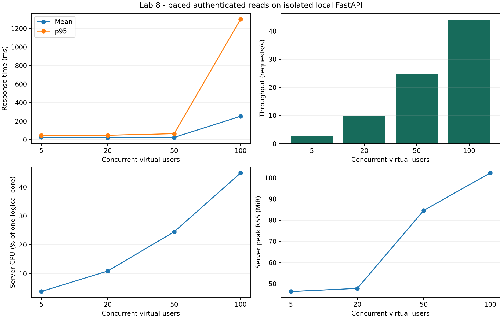

# №8 зертханалық жұмыс жүктемелік тест нәтижелері

2026 жылғы 19 қарашада төрт сценарий толық орындалды. 5, 20 және 50 пайдаланушыда қате тіркелмеді; 100 пайдаланушыда жауап уақыты өсіп, 3 сұрау HTTP 500 қатесімен аяқталды. Барлық виртуалды пайдаланушы саны Locust тарихындағы нақты максимуммен расталды. Нәтиже қалыпты кідірісі бар аутентификацияланған оқу сұрауларына қатысты.

| Пайдаланушы | Ұзақтығы с | Сұрау | Орташа мс | p95 мс | Сұрау с | Қате саны және үлесі | CPU орташа % бір ядро | Ең жоғары RSS MiB |
|---:|---:|---:|---:|---:|---:|---:|---:|---:|
| 5 | 60 | 163 | 27.20 | 48 | 2.72 | 0 / 0.00% | 3.83 | 46.34 |
| 20 | 120 | 1181 | 21.65 | 48 | 9.87 | 0 / 0.00% | 10.93 | 47.82 |
| 50 | 180 | 4438 | 25.04 | 65 | 24.66 | 0 / 0.00% | 24.50 | 84.63 |
| 100 | 180 | 7945 | 252.73 | 1300 | 44.11 | 3 / 0.04% | 44.87 | 102.29 |



## Орта және әдіс

ОЖ — Windows-11-10.0.26300-SP0; процессор — Intel64 Family 6 Model 140 Stepping 1, GenuineIntel; 4 физикалық, 8 логикалық ядро; RAM — 7834.5 MiB. Python 3.12.15, Locust 2.47.0, psutil 7.2.2. Бір Uvicorn процесі және SQLite қолданылды. Сервер мен жүктеме генераторы бір компьютерде орындалды; компьютердегі басқа процестер тоқтатылған жоқ.

Жүктеме сервері 05:15:20 UTC кезінде іске қосыла бастады. Оның жүктелген `app/` коды `a3580b4` нұсқасына сәйкес: процесс кейін енгізілген `app/main.py` қате журналын бүркемелеу түзетуіне дейін модульдерді жүктеді және autoreload қолданған жоқ. Бұл сервердегі ескі `Audit request failed` белгісімен де расталады. Түзету тек күтпеген қатені өңдеу мен журналдауға қатысты; `app/auth.py`, `app/store.py` және жабдық API жолдары өзгермеген. Түзетуден кейінгі 24/24 интеграциялық тест нәтижесі бөлек тексеру болып саналады; осы жүктеме нәтижесі жаңа error middleware үшін қайталама өлшеу емес.

Әр әрекеттен кейін 1–3 секунд кідіріс бар. Сұраулардың жоспарланған салмақтары: жабдық тізімі 30%, іздеу 20%, жабдық мәліметі 20%, санаттар 10%, бөлмелер 10%, dashboard 10%. Нақты маршрут үлестері raw CSV файлдарында берілген. Барлық пайдаланушы шамамен бір секундта іске қосылады; бұл кезең берілген 60/120/180/180 секундқа кіреді. Locust аяқталуында жүріп жатқан сұрауға 15 секундқа дейін беріледі; нақты тіркелген терезелер JSON ішіндегі `observed_window_seconds` өрісінде көрсетілген.

100 бөлек серверлік сессия бір синтетикалық әкімші үшін нақты login API арқылы алдын ала жасалды. Пароль тек уақытша процестің stdin арнасымен жіберілді; login және scrypt есептеуі өлшенетін уақытқа кірмейді. Әр виртуалды пайдаланушы өз cookie сессиясын қолданады. API авторизациясы мен дерекқордағы сессия тексерісі әр өлшенген сұрауда орындалады. Бизнес деректерін өзгерту, файл жүктеу және AI inference бұл сценарийге кірмейді.

Сервер тек 127.0.0.1 адресінде, жаңа уақытша SQLite базасында жұмыс істеді. Базаға 4 жабдық, 3 санат және 3 бөлме, сондай-ақ жобаның синтетикалық оқу деректері енгізілді. Жұмыс жобасының негізгі базасы қолданылған жоқ. Арнайы жауап тақырыбы арқылы мақсаттың оқшауланған тест сервері екені тексерілді; сыртқы URL беру параметрі жоқ.

CPU және RSS нақты сервердің Python процесінен секундына бір рет алынды. Windows виртуалды орта launcher процесі есепке кірмейді. Бұл іске қосуда таймер басталғанға дейін қосылған тәуелсіз sampler қолданылды; қайталанатын сценарий коды енді нақты interpreter процесін өзі таңдайды. CPU 100% — бір логикалық ядро; бүкіл компьютер CPU көрсеткіші барлық ядроға нормаланған. RAM ретінде процесс RSS көрсетілген. Терезе шекарасын кесетін алғашқы интервал есепке алынбайды: sample аяқталуы `[Locust start + 1 секунд, Locust end]` аралығында болуы керек. p95 — Locust гистограммасының бағасы.

## 50 және 100 пайдаланушыны салыстыру

50 пайдаланушыда орташа жауап 25.04 мс, p95 65 мс; 100 пайдаланушыда тиісінше 252.73 және 1300 мс. Орташа уақыт арақатынасы — 10.09; өткізу қабілеті 24.66-ден 44.11 сұрау/с деңгейіне өзгерді. Қате саны 0-ден 3-ге, үлесі 0.00%-дан 0.03776%-ға өзгерді. 100 пайдаланушыда p99 — 5200 мс, ең ұзақ жауап — 12454.65 мс.

Үш HTTP 500 қатесінің екеуі жабдық іздеуде, біреуі бөлме тізімін оқуда тіркелді. Сервер журналындағы сәйкес үш қате оқиғасы `sqlite3.OperationalError: database is locked` қатесін көрсетті: ол `current_principal → Store.connect → BEGIN IMMEDIATE` тізбегінде шыққан. Сондықтан осы сұраулардың қате механизмі расталды. Барлық баяу жауаптың себебін тек осы өлшеумен анықтауға болмайды; ұзақ кідірістердің таралуы қосымша профильдеуді қажет етеді. [Қауіпсіз диагностикалық жазба](load-errors.json) бастапқы traceback пен жергілікті жолдарды қамтымайды.

Сервердің орташа CPU шығыны 24.50%-дан 44.87%-ға, ең жоғары RSS 84.63 MiB-тан 102.29 MiB-қа өзгерді. CPU мен RAM әртүрлі өлшемдер болғандықтан оларды бір абсолютті сан ретінде салыстыруға болмайды. Бұл нәтиже өздігінен ресурстың толық таусылғанын немесе нақты bottleneck барын дәлелдемейді.

Оңтайландырудан бұрын профильдеу керек. `app/auth.py` әр қорғалған сұрауда сессияның `last_seen_at` мәнін жазады; расталған lock қатесіне байланысты SQLite жазу транзакцияларының күту уақытын өлшеу орынды. Одан кейін сессия белсенділігін жазу жиілігін қауіпсіз азайту, ресурстар тізіміндегі байланысты ORM жазбаларын бір сұраумен алу және үлкен жазу жүктемесінде PostgreSQL қолдану бағаланады. Ұсынылған өзгерістердің өнімділікке әсері әлі өлшенген жоқ.

Жүктеме тек шағын синтетикалық базаға, бір компьютерге және бір рет орындалған қалыпты оқу ағынына қатысты. Жауап уақытына алдын ала SLA шегі қойылған жоқ; нәтиже өндірістік максимал қуат кепілдігі ретінде қолданылмайды.

## Қайта орындау

Репозиторий түбірінен Windows PowerShell командалары:

```powershell
.\.venv\Scripts\python.exe -m venv .tools/lab8-load-venv
.\.tools\lab8-load-venv\Scripts\python.exe -m pip install -r requirements.load.txt
.\.tools\lab8-load-venv\Scripts\python.exe scripts/lab8_load.py
```

Жүктеме тәуелділіктері негізгі `.venv` ортасынан бөлек сақталады. Таза орнатуда backend ортасын алдымен жобаның README нұсқаулығымен дайындау керек. Скрипт өз уақытша серверін іске қосып, төрт сценарийді ретімен орындайды және соңында оны тоқтатады. Пароль, cookie және уақытша дерекқор нәтижелерге қосылмайды.

## Өлшеу дәлелдері

Сұраулардың қорытынды саны Locust аяқталу оқиғасындағы JSON-нан алынды. Raw CSV — периодтық snapshot; ол аяқталу кезінде біткен бірнеше сұрауға қалып қоюы мүмкін. CPU/RAM CSV файлдары тиісті сценарийдің нақты өлшеу терезесіне іріктелген.

- [Толық метрикалар және орта](load-summary.json)
- [Жиынтық CSV](load-summary.csv)
- [5 пайдаланушы маршруттары](load-005_stats.csv) және [процесс ресурстары](load-005-resources.csv)
- [20 пайдаланушы маршруттары](load-020_stats.csv) және [процесс ресурстары](load-020-resources.csv)
- [50 пайдаланушы маршруттары](load-050_stats.csv) және [процесс ресурстары](load-050-resources.csv)
- [100 пайдаланушы маршруттары](load-100_stats.csv) және [процесс ресурстары](load-100-resources.csv)

Locust-тың [headless орындау нұсқаулығы](https://docs.locust.io/en/stable/running-without-web-ui.html) runtime-ның іске қосу кезеңін де қамтитынын түсіндіреді. [Пайдаланушы сценарийінің нұсқаулығы](https://docs.locust.io/en/stable/writing-a-locustfile.html) `HttpUser`, салмақталған тапсырмалар және think time тәртібін сипаттайды.
